# Penbook — Architecture and intended application

**Status:** Living founding specification · 28 November 2026  
**Development phase:** Exploratory; not a stable file format or production release  
**Companions:** [Vision](PENBOOK_VISION.md) · [Prototype 01](PENBOOK_PROTOTYPE_01.md) · [Agent guidance](AGENTS.md)

## 0. Reading and maintaining this document

This is the theoretical Penbook application as understood at the end of the founding discussions. It describes the target behaviour and architectural possibilities, including capabilities beyond any current implementation. It is **not a feature backlog, a roadmap or a requirement to build everything at once**. The active prototype brief alone defines implementation scope.

Decision maturity is identified throughout:

| Status | Meaning |
|---|---|
| **Established** | Agreed direction. Implement consistently; change deliberately after discussion or evidence. |
| **Provisional** | Preferred approach at present; details or feasibility need testing. |
| **Open** | Meaningful design question not resolved; do not present a speculative solution as a decision. |
| **Deferred** | Intended or possible functionality outside current scope. Its precise design may still be open. |

An established direction need not imply a frozen API, exact schema or dependency. A deferred capability can have established architectural principles. Implementation details should remain replaceable. Where this document offers an illustrative JSON structure or API, it is an explanation of intent, not a stable contract to copy literally.

The [Vision](PENBOOK_VISION.md) establishes why Penbook exists; this document establishes what it is and how its capabilities relate. Each prototype defines what is built now. Update this architecture when learning changes the intended system; record implementation outcomes in the corresponding prototype evaluation rather than turning the architecture into a progress log. Do not introduce a predetermined roadmap: define subsequent milestones after evaluation.

### 0.1 Design history and evidence

Penbook is a clean synthesis of the original digital Notebook/sketchbook, Graphic Pad and HTML Notes/HTMDoc explorations. The Website Builder and related experiments provide valuable examples of a thin compositional grammar. None is a required code dependency.

The first two Penbook tests deliberately compared two different authoritative representations:

- A (A2): a constrained, structured native HTML document, edited through its DOM and CSS conventions. It was not a general arbitrary HTML editor.
- B (B2): a thin declarative JSON composition model with native content payloads and generated HTML/CSS/SVG.

The decision is to pursue **B's architectural direction**, not B's implementation. A and B were quick, disposable feasibility tests, not the first proper prototype. In the inspected source, A had direct DOM editing and relatively compact output; B had clearer identities, relationships, validation, layout conversion and explicit authoring data. B's central type switches, broad rerenders, duplicated output and snapshot history illustrated limitations to avoid, not patterns to inherit. The respective ten sample documents totalled about 64 KB and 151 KB, but their content differed, so this is not a controlled size or performance comparison. The test evidence did not establish comprehensive browser/device behaviour. Start Prototype 01 independently, with a fresh schema and module boundaries.

A separate format experiment compared JSON, HTML with embedded source, and ZIP-based `.penbook` files. The later editing benchmark established that guided, narrow agent access can be efficient in both HTML and ZIP; see §11. This helped confirm HTML as the initial everyday document format, not HTML as the authoritative composition model.

## 1. System identity and boundaries

**Established.** Penbook is a browser-only, local-first, file-first creative notebook and composition application. Its common document engine enables text, sketching, graphical work, visual organisation, layouts, reports, presentations and optional interactive material without declaring separate fixed document species.

It is not a computational dataflow environment such as CAD Studio or Patchwork. Content modules do not need to exchange computational data with each other. They coexist in a composition and may use common services, resources and future declarative references. Do not introduce a general event bus between blocks, dependency graph of tools, shared CAD data-type system or dynamic plugin platform unless a concrete later need changes the architecture.

The engine should be small relative to its possibilities. Implement general relationships from which features emerge. Prefer native web capabilities to replacements for HTML/CSS/SVG/JS. Introduce abstractions only for meaningful composition, authoring, portability and consistency.

### 1.1 Architectural map

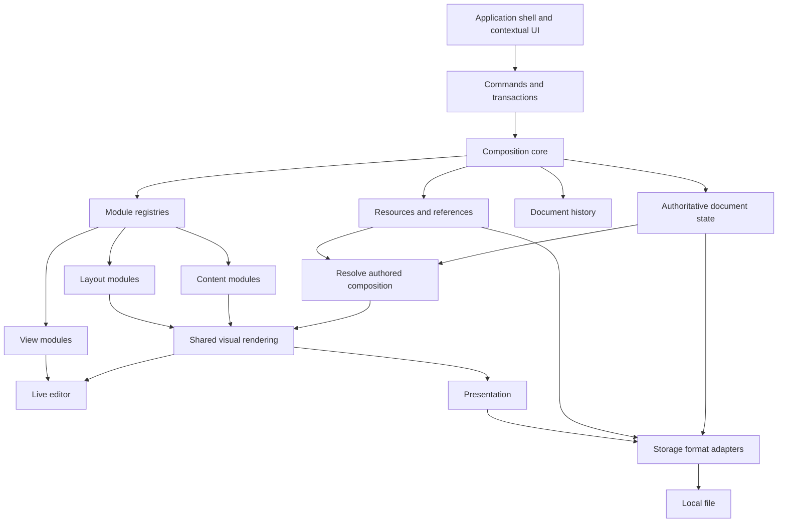

The editor and exporter are consumers of the same document source. No second editable DOM model is maintained. The format layer knows about file encodings and containers; the composition core does not depend on the currently selected storage envelope.

### 1.2 Responsibility boundaries

| System | Owns | Must not become |
|---|---|---|
| Composition core | Document identity, authored tree, generic block operations, state/transactions/history, validation, selection, resolution contracts | A collection of content-type-specific branches |
| Content module | Own content model, validation, render, internal editing, module properties and tools, optional presentation behaviour | A second global document manager or an unrestricted mutator of other blocks |
| Layout module | Placement and sizing rules for a container's immediate children; layout properties, relevant manipulation/commands | A content editor or document type |
| View module | How a composition is navigated and experienced | A second layout engine that rewrites content |
| Resource service | Resource IDs, payloads, access, lifetime, metadata, storage/permission resolution | A mandatory global media database |
| Format adapter | Parsing, encoding and saving files, extracting source and packaging output | The authority on composition semantics |
| Presentation resolver/exporter | Resolve effective structure and properties; emit visual output and include required dependencies | An independent editable source |
| Application shell | UI regions, command palette, contextual tool placement, presets, file workflow, settings | The owner of the internal features of each module |

Exact package boundaries are provisional. Ordinary JavaScript modules and explicit registration are sufficient. Do not build all the boxes in the diagram as independently deployable systems or speculative interfaces.

## 2. Fundamental document model

### 2.1 Documents, blocks and containers

**Established.** A document has a stable identity, metadata (name/title, optional tags and future user properties), a root container, its document configuration/preset and references to its resources and future reusable definitions.

Every compositional object is a **block**. A block is one of two conceptual kinds:

- **Container block:** contains an ordered set of child blocks and specifies their arrangement.
- **Atomic content block:** owns one content type and its associated payload/properties. It contains no other Penbook composition blocks.

Both have stable identities, types and properties. A container can contain another container or any content block. A content block may have complex *internal* structure (vector objects, raster layers, spreadsheet cells, chart marks, model geometry, gallery records) without those internal elements becoming independently composable Penbook blocks. Atomicity is about the composition boundary, not content complexity.

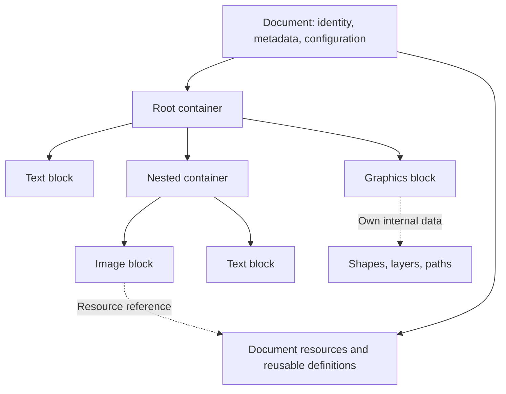

No compulsory hierarchy of book, section, chapter, page and item. The root may be a note, board, sheet, page sequence or any supported composition. The user chooses document granularity. A notebook of many pages, a folder of separate sketches and an individual page are equally valid. Pages/slides are normally ordinary fixed-extent child containers in a sequence; frames on an infinite board can similarly be ordinary nested fixed containers, not a parallel page model.

A visible tag/label is content or styling; a document or resource tag is metadata. Do not conflate them. The exact tagging scope (document, block, resource) is open beyond initial document-level needs.

### 2.2 Authored model versus resolved model

**Established.** The authoritative composition model is JSON with a thin application-specific grammar. In memory it is ordinary JavaScript data, backed by resources that can be binary objects rather than strings. Native content formats remain native where appropriate: Markdown for text (preferred, details open), SVG for graphics, ordinary image bytes for raster content, HTML/CSS/JS and parameter data for custom computational material, geometry in suitable native representations.

The authored data is the single editable source. A resolved composition is derived from that data: effective properties, layout placements, resource references and, eventually, components and generated collections. The visual DOM, measurements, caches, preview markup, tessellation and similar results are not independent authored representations. Do not reconstruct the document by reverse-engineering the generated DOM.

This distinction allows styles and references later without requiring that the first prototype implement their entire resolution system.

Illustrative conceptual source, not a prescribed schema:

```json
{
  "format": "penbook",
  "schemaVersion": 1,
  "id": "doc-example",
  "title": "Study sheet",
  "root": {
    "id": "root",
    "kind": "container",
    "layout": { "type": "grid", "columns": 4, "rows": 4, "gap": 8 },
    "extent": {
      "x": { "mode": "fixed", "value": 800 },
      "y": { "mode": "fixed", "value": 600 }
    },
    "children": [
      {
        "id": "heading",
        "kind": "content",
        "type": "text",
        "placement": { "gridArea": [1, 1, 5, 2] },
        "properties": {},
        "data": { "markdown": "# Study sheet" }
      },
      {
        "id": "figure",
        "kind": "content",
        "type": "image",
        "placement": { "gridArea": [1, 2, 5, 5] },
        "properties": { "fit": "contain" },
        "data": { "resourceId": "image-a" }
      },
      {
        "id": "markup",
        "kind": "content",
        "type": "svg",
        "placement": { "gridArea": [1, 1, 5, 5], "drawOrder": 10 },
        "data": { "svg": "<svg xmlns=\"http://www.w3.org/2000/svg\" viewBox=\"0 0 800 600\"></svg>" }
      }
    ]
  },
  "resources": {
    "image-a": { "mime": "image/webp", "storage": "embedded" }
  },
  "preset": { "view": "canvas", "preferredMode": "composition" }
}
```

The image bytes in this illustration belong to the resource store, not the text model. The layout field names, coordinate representation, use of discriminated `kind`/`type` fields and schema version numbering are provisional examples. The JSON source should still be intelligible if separated from its binary resources; visual reconstruction of an image requires its actual resource, not merely the ID.

### 2.3 Properties and identity

**Established.** Distinguish the following classes of information, whether or not the implementation uses separate objects:

| Information | Examples |
|---|---|
| Common block properties | Name, visibility, appearance, sizing intention, optional lock |
| Container-specific properties | Extent, child layout, gap, padding, background, clipping |
| Placement in parent | Grid area, free position, rotation, flow order, draw order |
| Module-specific properties | Image fit, text formatting, sketch canvas characteristics |
| Content data | Markdown string, asset ID, SVG, drawing or record data |
| References | Asset IDs, future style/component references, links |

The parent layout owns the rules of external arrangement; a child can own or carry its parent-context placement record, but the content module does not decide external placement. The module owns what happens inside the assigned region and may report intrinsic size or size constraints. Preserve this responsibility distinction even if placement is physically stored on a child for easy editing.

Stable IDs distinguish meaningful identities from display names, array positions and coordinates. Moving/reparenting keeps identities; duplicating creates new IDs and remaps internal references; deletion handles dependants deliberately; copying between documents brings necessary resource and definition dependencies and handles collisions. Reject cycles and ambiguous references. Derived instances/records need deterministic scoped identities if required for UI, without pretending to be individually authored blocks.

The exact ID scheme, tree versus normalised in-memory indexes, handling of cross-document IDs and reference schema are open. Prefer the simplest representation that supports clear semantics and efficient lookup.

### 2.4 State ownership

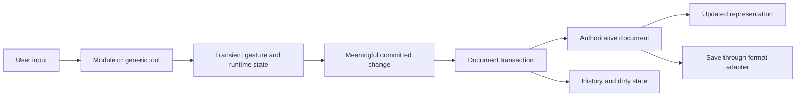

- **Authoritative document state:** authored content, composition, resources, saved configuration and future definitions. It survives saving/reopening.
- **Authoring runtime state:** uncommitted stroke, caret, pointer capture, GPU buffers, object URLs, measurements, temporary editing tools and other reconstructible internals. A module owns its internal transient state; the shell owns global session state.
- **Application settings:** reusable presets, theme, general defaults, file handles and non-document preferences; not the document database.
- **Presentation runtime state:** temporary viewer-side filters, parameter edits, camera navigation, selections. It does not modify the saved document or flow back to its author.

A camera position or other value can also be a deliberately saved authored initial property; the temporary navigation state is a different thing. Do not serialize incidental runtime machinery or selection outlines.

## 3. Spatial system

**Established.** Layout, extent, child sizing, placement, structural order, draw order and view are independent dimensions. Together they enable both web-like documents and precise graphical compositions. Avoid a separate layout engine for each named use case.

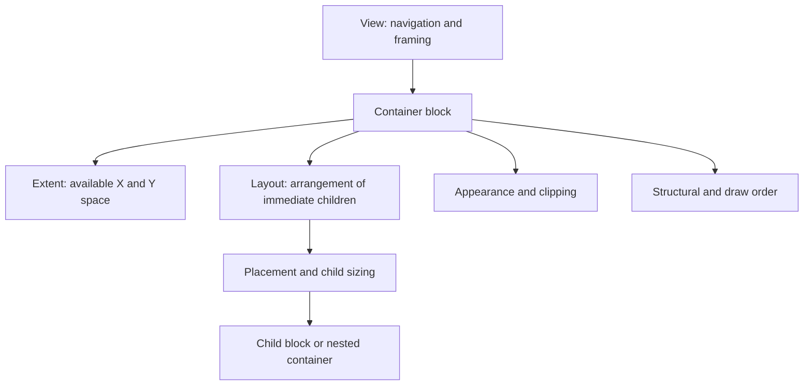

### 3.1 Extent and units

Specify the constraints on X and Y independently. A container may be fixed on both axes, fixed on one and content-driven on the other, responsive to available space, or effectively unbounded for spatial work. These are not incompatible document types.

| Extent | Meaning |
|---|---|
| Fixed | Authored dimension independent of viewport; zoom does not alter it. |
| Content-driven / auto | Expands or fits according to the arranged content. |
| Responsive / available | Depends on the containing region or viewport according to an explicit rule. |
| Unbounded | Navigable spatial region without a user-imposed page boundary; render/export uses finite bounds. |

A fixed-width, auto-height vertical flow behaves like a conventional note; a responsive-width flow like a web document; a fixed rectangular extent like paper or a slide; an unbounded freeform region like a board. Nested extents are relative to their parent allocation and must resolve without circular sizing dependencies. Unbounded inside a finite parent needs a defined viewport or finite resolved bounds. An unbounded canvas is not literally infinite DOM dimensions.

**Provisional:** use CSS pixels as the common logical coordinate unit; display/enter millimetres, centimetres, percentages, standard paper sizes and ratios where appropriate. Print dimensions need deliberate conversion; CSS pixels are not physical monitor pixels. Maintain document coordinates independently of camera zoom and pan; do not bake viewport transforms into saved positions. Whether the print-like proportional `cqw` scheme from Website Builder is useful as a separate sizing option, and how responsive reflow versus proportional scale is exposed, remain open. Do not import that site's global scaling assumptions by default.

### 3.2 Layouts and placements

Initial foundational layouts:

| Layout | Arrangement rules |
|---|---|
| Freeform | Explicit X/Y position, size, optional rotation and alignment in the parent's local coordinates; overlapping permitted. |
| Flow | Horizontal or vertical direction, child sequence, alignment, gaps, padding; content-fitting and fill behaviours; wrapping/advanced distribution can evolve. |
| Grid | Explicit tracks/divisions, child area/spans, gaps, padding and alignment; multiple children may occupy the same area. |

Use native CSS positioning, Flexbox/flow and Grid where suitable. Define a bounded, explicit supported vocabulary rather than arbitrary CSS manipulation or an unnecessarily comprehensive layout DSL. Grid can initially use equal tracks and start/end coordinates, as Website Builder does; track sizing, row/column units, responsive breakpoints, wrapping, constraints and advanced layouts are later design questions.

A persistent layout rule differs from a one-off arranging command. Align, distribute, arrange into a grid or snap-to-grid can reposition freeform children without changing the container's layout type. A gallery-like arrangement can be a grid preset. Smart layout can initially emerge from combinations of flow/grid rather than a new layout engine.

Child sizing should support meaningful per-axis fixed, fit-content/intrinsic and fill-available behaviours; aspect ratio/proportional sizing can add further control. Some combinations need limits or clear fallbacks (e.g. a fill child in an unconstrained axis). Layout owns the allocated rectangle; content controls its own fit/overflow inside. Background, border, radius, padding and clipping are container appearance/behaviour, not separate document types.

### 3.3 Three orders and overlap

**Established.** Structural order (tree/sequence), spatial placement and draw order must not be conflated. Structural order is useful for traversal, reading, flow and accessibility. Grid position may be independent of it. Draw order controls stacking among overlapping siblings, normally within a container's stacking context. Define deterministic tie-breaking. A child inside another stacking context should not unexpectedly leap above unrelated ancestors.

In a fixed architectural report page, several text and drawing blocks may occupy different grid cells while one SVG annotations block spans the entire grid and is drawn above them. Its content can have transparent areas and arrows crossing several underlying objects. This is just an ordinary block with a placement and draw priority, not a special annotation subsystem. CSS Grid permits overlapping areas; CSS stacking can implement the visual relationship.

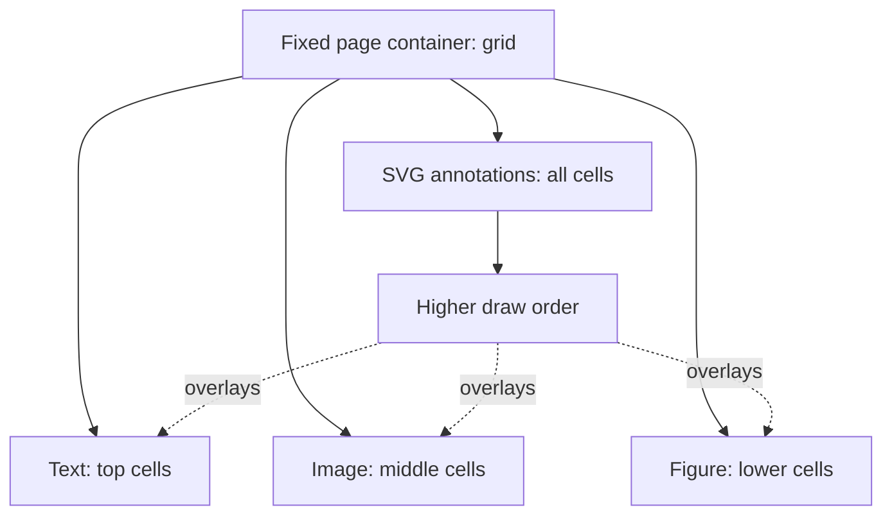

Interaction needs separate treatment: a full-page transparent layer must not make the underlying blocks unreachable. The hierarchy provides an unambiguous selection route; later options include locking, hit testing visible geometry, cycling through overlaps and explicit draw-order controls. Exact pointer behaviour is open. An annotation is not automatically anchored to underlying objects or updated by their movement; semantic anchoring would need a deliberate later feature, not implicit inter-module messaging.

### 3.4 Layout conversion and nesting

Changing a layout changes the rules of child arrangement, not the child content, ID, assets or internal geometry. Define deterministic conversion and explicit outcomes. Spatial-to-flow ordering can use row-major position with stable tie-breaking, rather than arbitrary DOM traversal. Preserve structural order when appropriate; document which rule is applied. Retain prior freeform placement and relevant layout-specific placement where practical so that free → grid → flow → free can restore earlier arrangements. Do not assume all conversions are lossless or visually equivalent. Warn about approximations and make operations undoable.

Changing view alone must not mutate layout or source. Changing extent, resizing or reparenting are explicit authored changes. When reparenting, transform coordinates or derive a valid placement for the new parent; preserve IDs and content. Reject cycles and invalid geometry. The meaning of resize, including content reflow versus proportional scale, depends on sizing/layout rules and module capabilities, not on the document preset name.

Nested compositions use the same principles recursively: flow inside a board, fixed frame inside an unbounded composition, freeform drawing area inside a flowing report, grid on a slide, report sections inside another container. Selection and manipulation must work at the appropriate nesting depth.

### 3.5 Views

**Established.** A view governs navigation/framing/experience of the composition, not its authored arrangement. Support scroll, pan/zoom and page/slide navigation. Book-like spreads, overview/navigation trees, thumbnails, focused page views or a gallery of pages are possible later view implementations. A paged document may be a vertical or horizontal sequence of fixed-size child containers, navigated one at a time in a paged view or continuously in a scroll view.

A board export may use content bounds or selected fixed frames; a paged export may use child frames in explicit sequence. Frames could carry titles, page order, visibility in navigation and inclusion in print/export. This derives from the earlier Graphic Pad board/frame idea, not an obligation to preserve Graphic Pad's exact board model. The precise export framing and view selection conventions remain open.

| Configuration (example, not type) | Extent | Layout | View |
|---|---|---|---|
| Text note | Fixed or responsive X, auto Y | Vertical flow | Scroll |
| Whiteboard / moodboard | Unbounded X/Y | Freeform | Pan/zoom |
| Poster / architectural sheet | Fixed X/Y | Grid or freeform | Pan/zoom / fit |
| Presentation | Fixed 16:9 child frames | Sequence, nested grid/freeform | Slides |
| Sketchbook / journal | Fixed child pages | Sequence of containers | Paged, book or scroll |
| Website-like document | Responsive/available X, auto Y | Nested flow/grid | Scroll |
| Gallery | Auto or bounded depending on context | Grid or flow | Scroll/canvas |

These are combinations of independent properties, not a rigid enumeration of content types. The view can be changed without deleting or reinterpreting the material.

## 4. Module architecture

### 4.1 Independent, registered implementations

**Established.** Use a modest registry-based module architecture. The core operates on generic block identities, data, transactions and containers. It does not know how to draw a stroke, parse a Markdown heading, calculate a spreadsheet cell or orbit a 3D model. A module knows its content type and internal behaviour; a layout module knows how to arrange immediate children; a view module knows how to navigate a composition; a format adapter knows how to read/write a file envelope.

Ordinary bundled JavaScript modules with explicit registration are sufficient. No marketplace, dynamic loading of arbitrary extensions, inter-module messaging, general dependency graph or separate runtime for every block is needed. A registration file may import each module explicitly; generic dispatch is preferable to content-type switches scattered across the editor, validation and exporter.

Independent modules should be developable and testable in isolation, potentially in miniature standalone harnesses. An agent working on raster drawing should not have to read the entire text editor. Modules can use common services rather than duplicating saving, document history, command palette or resource management. Do not force every module to use the same internal rendering technology: a Canvas drawing tool, DOM text editor, SVG scene, table or WebGL renderer may be appropriate.

### 4.2 Content module contract

**Established responsibilities; provisional API.** Each module owns:

- Type ID, display metadata and initial/default data.
- Its content schema, supported properties, default values, validation and optional normalisation. Identify which properties are exposed in the generic inspector and eventually which are styleable.
- Rendering its content in its allocated region; intrinsic sizing/constraints where appropriate.
- Authoring lifecycle, internal editing UI and transient state, including entering/exiting active editing, focus and cleanup.
- Contextual commands, toolbar contributions and optional module-panel tools. It declares the functionality; the shell hosts the controls.
- Committing meaningful edits through the document transaction interface; efficient reversible operations where appropriate.
- Rendering/serialising its presentation, declaring its resource requirements and any necessary presentation dependencies.
- Optional source access to its native payload, resource/reference enumeration and handling of internal IDs when copying.

The core should supply a small context: block identity/data, effective properties, assigned region, mode/activation, scoped commit and resource access, command registration and lifecycle facilities. Avoid handing a module unrestricted mutation of unrelated blocks, direct global file-saving authority, or a requirement to implement its own document history. Exact names, method signatures, update/diff strategy, mount API and component technology are open. The interface can grow only when real modules require it.

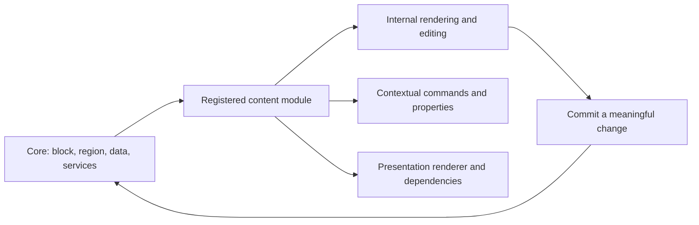

Common operations (add, move, duplicate, remove, resize, set a property) must work generically for all modules without their implementation being centralised in the core. Optional capabilities should truly be optional. Unknown content type data must not be destroyed: preserve it and present an intelligible unsupported-content placeholder or safe fallback. Invalid data and unsupported schema versions need explicit diagnostics, not silent conversion or destructive saves. Full migration infrastructure is not a requirement during exploration.

### 4.3 Layout, view and format contracts

A layout module declares supported placement and sizing properties, resolves or applies the arrangement of the immediate children, and provides generic-manipulation hooks or layout-specific commands where useful. Layout changes are model operations, not simply styles patched into a DOM. A view module controls navigation, coordinate mapping, framing and relevant controls; it must not secretly rearrange authored content. A format adapter maps disk representation to/from the same logical document and resource store and handles encoding-specific concerns. It is separate from both the model and the export presentation renderer.

A simple module registry may have distinct collections for content, layout, view and format implementations. Tool declarations from these modules feed the shell's command system. We do not need an independent, interconnected tool-module dataflow architecture. The line between separate tool utilities and module-specific commands can evolve as actual workflows emerge.

### 4.4 Updating and lifetime

**Established principle; implementation open.** An edit to one block should not destroy and recreate unrelated active content editors or viewers. Keep stable block identity, update affected rendered regions and maintain relevant transient module state. Mount/update/unmount deliberately. Changing a parent layout may remeasure or reposition children but should not reset their content state unnecessarily. Rebuilding an entire document on explicit open or full preview is different from doing so on every keystroke or slider change.

Use browser-native layout and measurement, not expensive duplicate geometry computation without need. Batch pointer-driven updates, defer heavy work appropriately, release listeners, canvases, object URLs and GPU resources when no longer needed. Workers and lazy loading can be introduced where they demonstrably improve performance. The first prototype must prove module independence, not prescribe a full rendering framework.

## 5. Authoring, presentation and source

### 5.1 One visual document

**Established.** The central working surface is the live rendered document. Visual authoring should look as close as possible to final presentation. Editing affordances, outlines, handles, temporary selection and module tools are additional authoring layers. Do not maintain independently designed authoring and final visual documents. Reuse the visual rendering logic wherever practical, while accepting that an editor (e.g. Canvas or Markdown source input) may have temporary controls absent in the presentation.

Three complementary access surfaces:

| Surface | Behaviour |
|---|---|
| Editor | Live, visually editable composition, with two editing modes (see §6) and contextual tools. Persistent edits go through document transactions. |
| Preview / presentation | The same document without authoring chrome; optional reader interaction. Can be experienced inside Penbook and in standalone HTML. |
| Source | Inspect/edit the authoritative document JSON or the selected module's native payload. Generated HTML is inspectable but not authoritative. |

Source editing is an explicit operation: parse and validate before applying; report errors and preserve the last valid state. A native payload (Markdown, SVG, future script) should be editable directly without navigating unrelated JSON or asset bytes. Source view is not the normal writing experience. A text editor may be Obsidian-like live Markdown, a formatting-toolbar-driven rich editor that preserves Markdown, or a simpler source/rendered toggle initially; exact implementation is open. Prefer straightforward working behaviour over an elaborate editor for Prototype 01.

### 5.2 Presentation is a capability, not a separate document kind

**Established.** Every module has a presentation representation. Most ordinary modules are static in the exported document. A module may optionally expose selected interactive capabilities; it defines what these are. Authoring functionality is not carried into the reader interface just because the source is editable in Penbook.

| Module | Authoring | Presentation example |
|---|---|---|
| Text | Write/format/edit Markdown and properties | Formatted text, ordinary links |
| Image | Replace, fit/crop, caption, configure | Static image |
| Raster sketch | Draw, erase, paste, pen tools | Static image |
| Graphics / SVG | Edit geometry, layers, shapes, styles | Static SVG |
| Gallery | Manage records, metadata, filters, display | Static gallery or viewer sorting/filtering/grouping |
| Diagram | Create and connect nodes, edit semantic data | Static or navigable diagram |
| Chart / table | Edit data, formulas or display configuration | Static or interactive results |
| 3D model | Import/configure, author initial view | Orbit/pan/zoom viewer |
| Parametric model | Edit script, parameters and output configuration | Change exposed parameters, regenerate, navigate geometry |

Presentation state is temporary by design. Adjusting a parameter, filter or camera in a standalone HTML does not change its authoritative JSON or save back to the file. Reopening resets to the authored initial state unless a future explicitly separate viewer preference is introduced. No writable authoring API is exposed in the presentation. A reader can still manually edit any local file using other software; this design is not a security claim that the file cannot be modified.

### 5.3 Dependency bundling and execution

**Established:** self-contained HTML includes only the presentation dependencies used by its actual composition, ideally once per document. A text note should not contain the Penbook editor, a sketch editor, unrelated modules or a geometry kernel. Static output should need little or no JavaScript other than any essential asset-resolution mechanism. Rich interactive modules may need JavaScript, data, styles, fonts, WASM and workers; include what is necessary for offline viewing and validate that local browser execution actually works. Such documents are expected to be relatively rare compared with everyday notes.

The modules are shipped with Penbook; exporting does not require downloading a module at view time. Do not assume that a complex WASM library automatically runs from `file://` simply because its bytes are embedded. Worker/import URLs, CSP, browser security, cross-origin isolation and licensing can affect feasibility. Test each computational module's self-contained deployment separately. Kernel choice and packaging are deferred.

Hiding a script editor is not protecting source code. A self-contained interactive document necessarily exposes any bundled source or executable logic to inspection. Penbook is currently intended for personal use, offline work and sharing, not distributing confidential commercial computation. A proprietary online service requiring hidden computation is outside this architecture's immediate goals.

**Safety boundary (established principle, deferred implementation for executable modules):** opening untrusted documents in the authoring app must not automatically execute imported scripts or active markup. Native SVG and rich text need sanitisation or a safe rendering boundary; JSON is inert data, not executable code. Future custom HTML/CSS/JS blocks should use explicit activation/Run and Stop, sandboxed isolated contexts without same-origin access to editor DOM, filesystem handles or unrestricted app state, narrow declared inputs, restricted external requests/navigation where feasible, and clear trust indicators. Standalone untrusted custom executable content should likewise require deliberate activation. Built-in trusted presentation controls can have different activation rules once defined. Sandboxing is not a guarantee against resource exhaustion or all malicious behaviour. Scope security testing to what actually ships.

## 6. Interaction, commands and history

### 6.1 Two persistent editing modes

**Established.** Composition mode and content mode are application working modes, not separate documents. Content mode persists as the user moves between blocks; do not force repeated double-click entry/exit for routine writing and pen work. The current mode is session state, with a preferred opening mode available in a preset.

| Mode | Pointer/keyboard intent | Available editing |
|---|---|---|
| Composition | Treat a block as an object in its parent | Select, move, resize, nest, reorder, duplicate, delete, change placement and draw order; edit common, layout and exposed module properties. |
| Content | Route gestures into the currently active content block | Type, draw, edit internal graphics, crop an image, work with cells or navigate module-specific internal UI. Properties remain available; specialised contextual tools appear. |

A drag may move an entire sketch in composition mode and draw inside it in content mode. Clicking text in content mode should feel like writing, not selecting a layout box. Clicking a different content block switches the active editing context and its tools. Normally one content block is actively edited at a time; multiple compositional selection remains meaningful in composition mode. Generic insertion, hierarchy navigation, save and global commands remain accessible as appropriate.

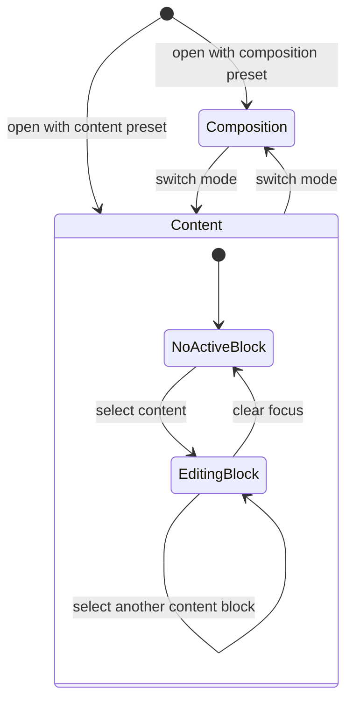

Changing mode must not lose a committed edit, accidentally apply a drag to two levels, or leave stale tools active. Commit or explicitly cancel transient gestures when focus changes. Navigation gestures, input focus, keyboard shortcuts and pointer capture must have clear ownership. Exact gestures and shortcuts remain experimental.

### 6.2 Selection and manipulation

Support single and multi-selection; select via the central surface and the document hierarchy. A nested container remains a block at its parent's level. Allow navigating selection depth and rearranging nested compositions without unnecessary isolated edit environments. Common operations include add, select, move, resize, reorder, reparent, nest/unnest, duplicate, delete and eventually clipboard transfer between documents. Explicit parent ownership prevents accidental cycles. Selection must remain possible when children overlap; the hierarchy is the reliable initial fallback.

Later refinements: selection cycling, lock/unlock, marquee, group/ungroup (through ordinary containers when appropriate), snapping, alignment, distribution, keyboard nudging, guides and placement handles. The vector module may offer similar internal operations at a different scale; do not make them composition operations by accident. Clipboard dependency remapping and sophisticated multi-selection across parents remain open.

### 6.3 Contextual commands and input

**Established.** All meaningful application/module operations should be accessible through a common command system; toolbars, menus, keyboard shortcuts and the command palette expose those commands. Continuous controls and editing gestures may use the same transaction interface rather than pretending every pointer move is a command. Available commands depend on selection, mode and module capability. Avoid global key handlers that steal normal text typing.

Mouse, keyboard, touch and pen are first-class intended inputs. Pen-first workflows should minimise mode changes; pressure, pen-only/palm handling and touch navigation are owned by the appropriate drawing module and view. Prefer natural standard behaviour: pan/zoom, direct drag, standard undo and typing. Earlier tools used `D` for pen, Space-drag or middle mouse for pan and other shortcuts; these are references rather than frozen Penbook bindings. Resolve conflicting Space/Tab/fullscreen/navigation conventions through actual testing. Desktop Chromium is the initial target, not the limit of long-term usability. Do not claim pressure or mobile testing without actual device evidence.

### 6.4 Unified document history

**Established.** Undo/redo follows one chronological sequence of document edits regardless of mode or module. If the user draws several strokes, moves the block, then draws another stroke, undo first removes the latest stroke, then reverses the move, then earlier strokes. Switching modes or selecting an object is generally not an authored change.

Modules define meaningful editing units, not independent histories that compete for Ctrl+Z. A stroke is one operation, not hundreds of pointer movements; a drag or typing session can be coalesced into a meaningful transaction. The core owns commit, undo/redo ordering, dirty state and validation. Transactions should apply atomically or roll back on failure. Undo/redo must handle resources and identity consistently. Resource lifetime must account for references and history; avoid deleting bytes still required to undo an action.

A small prototype may use snapshots or patches for lightweight JSON if justified, but avoid repeatedly copying entire large binary resources. Raster sketching may use reversible changed tiles (as Sketchnote already does); advanced geometry may require specialised reversible operations. Integrate them into the common timeline rather than importing their standalone histories unchanged. Exact history API, coalescing strategy, memory budget, whether history persists across reopen and efficient binary undo remain open. Persistence of history is not required for Prototype 01.

## 7. Application shell and contextual interface

**Established.** Engine-first development; UI should be clean and usable but refined incrementally. Contextual tools should make the application feel appropriate to the active content and work mode, not expose all capabilities permanently.

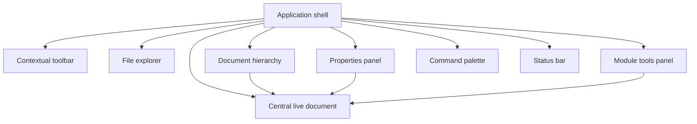

| Region | Responsibility |
|---|---|
| Central surface | Rendered document and authoring overlays, active view and editing mode. |
| Toolbar | Immediate contextual commands, tools, toggles and quick settings. Modules declare contributions; shell provides host and visual language. |
| File explorer | Browse a user-granted local folder, create/open/switch files. A document is not a database record. |
| Document explorer / hierarchy | Root and nested blocks, selection, ordering and reparenting; reliable access to covered/hidden blocks. |
| Properties panel | Persistent common block, parent placement, container and exposed module-specific properties; available in composition mode. Does not need to expose every internal datum. |
| Module tools panel | Optional specialised contextual editing UI: layers, brushes, complex menus, parameters, internal structure or script controls. Not required for every module. |
| Command palette | Search and execute registered commands, with appropriate context and shortcuts. |
| Status bar | Active mode, zoom/view, dirty/save status, version/commit where appropriate. |

The distinction between properties and module tools is semantic, not necessarily a requirement for two physically separate sidebars. A property changes persistent block configuration; a module tool may execute operations or manipulate complex internal content. Both can occupy standard shell-provided panels. Modules own their internal UI inside the block (e.g. canvas, text editing surface, 3D viewport, table), and declare external controls rather than each building a separate global interface.

Panels should be independently showable/hideable and configurable through presets. Floating/docked placement, resizing, icon-first controls, simple monochrome visual language with restrained highlights, light/dark themes, full-screen/focus modes and shortcuts can draw on other tools. Exact visual design and advanced docking framework are not foundational requirements. Default views should avoid clutter. Application theme need not change the document's authored appearance; a white paper or presentation can remain white in a dark shell.

## 8. Presets, settings and creation behaviour

**Established.** A preset is more than a creation template. It is a common configuration of working behaviour, UI, defaults, view and creation patterns. One always works with an **active preset configuration**, whether it corresponds to a saved named preset or has been adjusted temporarily. This provides specialised workspaces without a separate workspace architecture.

### 8.1 Three instances of one configuration structure

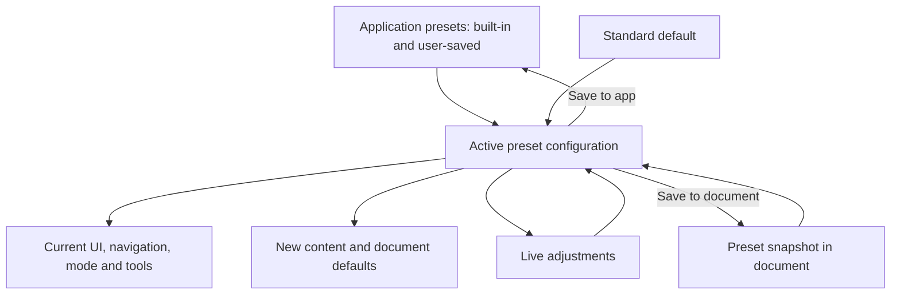

- **Application presets:** built-in and user-defined named configurations saved in local application settings; reusable across documents.
- **Document preset:** the configuration snapshot stored with a document. Opening that document activates it by default. Prefer a copy/snapshot rather than a fragile link to an application-local name; changes to an app preset must not silently rewrite existing documents.
- **Active preset:** working configuration in memory. Can be changed live without saving to the app or the document. Explicit actions save the adjusted configuration to either destination. Changing current mode, zoom or selection is not automatically a save of the entire preset.

Creating a document offers the current active configuration, a selected saved application preset, or the standard default. Instantiate appropriate initial content and save the chosen configuration with the new document. Opening an existing document uses its stored preset by default (fallback to standard default if absent/unsupported). The user may select another configuration temporarily without committing it.

### 8.2 What a preset can contain

Preferred view/navigation and initial editing mode; toolbar/panel layout and visibility; defaults for new containers, blocks, sizes, spacing and extent/layout; tool/input settings and preferred active tools; new-document initial composition; creation templates/behaviours for new pages or other units. Settings categories may be added gradually. Application-wide preferences such as theme and default preset may remain independent where desirable; the exact precedence of overlapping general/preset settings is open.

**Critical distinction:** preset defaults are not the authored properties of existing blocks. Selecting a different working preset may affect current UI/view and future creation. It must not automatically replace existing content, rearrange existing pages, or silently change authored layout/extent. Reconfiguring an existing container is an explicit composition operation. Actual layout/extent is stored on that container. If applying a preset offers to transform existing content, make the scope and consequences explicit and undoable. A saved document preset can define preferred future behaviour without becoming the authoritative geometry of its pages.

### 8.3 Example configurations

| Preset | Creation and spatial defaults | Working behaviour |
|---|---|---|
| Text note | Vertical flow, fixed/responsive width and auto height, initial text block | Scroll; content mode; typing controls |
| Sketchbook | Sequence of fixed-size pages, full-page raster sketch in each new page | Paged or book view; content mode; pen tools |
| Graphics journal | Fixed pages with full-page vector graphics block | Paged view; content mode; graphics tools |
| Board / moodboard | Unbounded freeform root, optional empty canvas | Pan/zoom; composition mode |
| Report / poster | Fixed-size pages or sheet, nested grid/flow | Paged or fitted canvas; composition mode |
| Presentation | Sequence of 16:9 frames, blank or title/content template | Slide navigation; composition mode |
| Web-like composition | Responsive root and nested flow/grid | Scroll; composition mode or content mode |

A sketchbook preset can create a full-page drawing module whenever a new page is added and default to content mode. The user can still switch to composition mode, place images/text above or alongside the drawing, change page layout or use a different module. The page creation template travels with the document. This is the intended mechanism, not a dedicated sketchbook engine. Full sketch/graphics presets become useful when their respective modules exist; Prototype 01 can demonstrate the same behaviour with a simple available block.

## 9. Reuse, generated composition and shared design

These capabilities are part of the long-term theoretical scope. **Deferred implementation**, with established general mechanisms. They should emerge from the block/property/resource model rather than require parallel object systems. Prototype 01 only preserves the relevant separation of authored/resolved state, stored/effective properties and identities/references.

### 9.1 Styles and property resolution

A named style is a reusable collection of declared styleable properties. Style definitions should use the same property vocabulary that ordinary blocks already use. Modules declare which properties can participate. A style controls appearance or relevant configurable properties; it is not a separate graphic structure or arbitrary selector cascade.

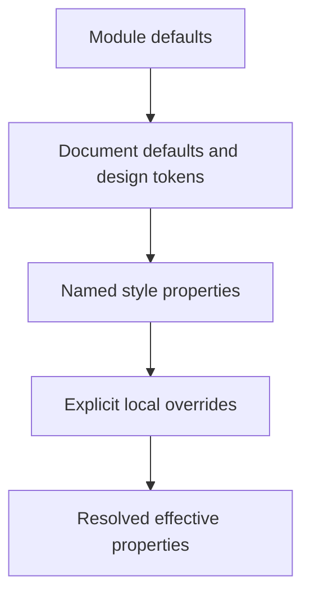

Preferred resolution order: module defaults → document defaults/design tokens → named style → explicit local overrides. Missing values inherit; resetting a local override returns to the inherited value. Editing a shared style updates blocks referencing it. Distinguish explicit stored properties from resolved effective values in the model and, eventually, in the inspector. A property such as a placement coordinate should not automatically be styleable just because it exists; styleability is declared deliberately. Multiple style composition, inheritance across containers, responsive variants and token syntax remain open. Prefer ordinary CSS variables/classes and native styling where useful.

Design tokens may include palette, font families, type scale/roles, spacing, borders and rounding; individual module properties may include image fit or drawing-specific style defaults. Reusable design principles from Website Builder and the Graphic Design System are relevant; do not require exact cross-app style schema before a demonstrated integration need.

### 9.2 Templates and components

**Established distinction.** Both are reusable ordinary compositions, not a different content language:

- **Template:** instantiate an independent copy of a block/subtree. It has new identities and can diverge freely. Used for new pages, slide layouts, blank report structures and initial preset content.
- **Component:** create a linked instance of a reusable authored block/subtree. A definition change propagates to instances subject to their explicit overrides. A detach operation converts a linked instance into an independent composition.

A definition may be a single atomic block or a container with nested blocks. Components allow reusable title blocks, cards, headers, repeated graphical motifs, legends and page furniture. Instances should have stable identity, local placement and clear rules about shared versus overridden content/properties. The authored hierarchy can reference definitions; the resolved representation expands them for viewing. Detect circular component references. Identity remapping, nested overrides, exposed slots/properties, definition editing and cross-document libraries need deliberate design later; no general-purpose inheritance language or speculative component engine now.

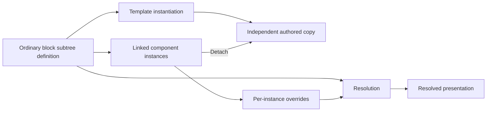

Terminology: a **content module** is an implementation; a **reusable component** is authored composition data; a **custom executable content block** is a potential content type. Do not confuse all three by giving them the same implementation contract. Website Builder historically used a more linked notion of a page template; Penbook's independent template versus linked component distinction is the currently approved terminology. A page can contain linked components inside an independently instantiated template.

### 9.3 Galleries, collections and queries

Three levels of functionality should be possible without forcing all galleries into the most complicated model:

| Level | Model and behaviour |
|---|---|
| Manual gallery | Ordinary grid/flow/freeform container with individually authored image/text blocks. No gallery module required. |
| Configurable gallery | Atomic content module owning its records, arrangement, captions and optional filters/sort/grouping. Its internal entries are not separately composable blocks. Can have static or interactive presentation. |
| Data-driven composition | A container behaviour or related general resolution mechanism that repeats an ordinary composition/component for a set of typed records or resources. Generated children are derived, not independently authored. |

The third level generalises beyond galleries to portfolios, material catalogues, object libraries, lists, contact sheets, structured research documents and repeated cards. It draws on Website Builder's asset library, collection queries, reusable composition definitions and layout separation. Do not introduce a broad data-driven framework just to create a first gallery.

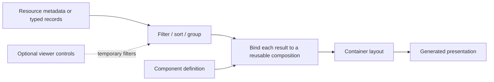

Possible future records: images with title, tags, captions, credit, date, project code, user properties; typed records with text, numbers, booleans, dates, select fields and resource references. Store an asset once and reference it from multiple uses. Start with typed, deterministic filtering (equality, array membership, contains where suitable; AND, explicit sort, bounded limit), not SQL or arbitrary evaluated expressions. Define context bindings and fail closed on missing context rather than accidentally matching all records. Website Builder's actual query implementation is evidence of a useful small mechanism, not a schema to inherit. Grouping, custom field schemas, record-editing UI, cross-document sources, binding syntax and interaction with components remain open.

A gallery should be able to change its visual arrangement without duplicating underlying resources. Generated elements may be inspected, but edits should target their source records, query or definition rather than silently turning them into independent authored blocks. A deliberate materialise/detach operation might make editable copies later. A viewer can change filters without saving them back. General collection resolution is not inter-module dataflow: it is a declarative interpretation of authored data.

## 10. Intended content modules and capabilities

The full application should eventually achieve the core compositional features of Website Builder (not the site-specific publishing system) and the essential graphical capabilities of Graphic Pad, with natural sketching and everyday text at equal importance. The list below is the current intended possibility space, not an ordered roadmap or a promise of exhaustive feature parity. Each module merits its own design discussion and prototype. Avoid importing the superficial implementations from the A/B tests. Develop the small modules well before multiplying their number.

### 10.1 Primary everyday modules

| Module | Intended authoring behaviour | Native content and presentation direction |
|---|---|---|
| Text | Fast writing; headings, paragraphs, lists, checklists, bold/italic, links, quotations, code, basic formatting; optional source view and toolbar; text naturally reflows inside its block. | Prefer Markdown source and native formatted HTML. Exact editor, extensions, table support within text and Markdown/rich-text round-trip policy open. |
| Image | Import/paste/replace, fit/contain/cover/fill or crop, caption/alt text, frame sizing, optional positioning within the frame; resource references. | Preserve ordinary image bytes; static ``/equivalent. Advanced crop and transform editing later. |
| Raster sketch | Immediate pen-first drawing, pressure, colour, thickness, opacity, eraser, lines/shapes, paste/import, grid/navigation, pen-only handling, clear and reversible edits. | Lossless WebP or PNG preferred for authored raster data; ordinary image presentation. JPEG can be an import/export format, not an ideal repeated-edit source. |
| Vector graphics / diagram | Create/select/edit shapes, paths, text, arrows, layers, groups; fill/stroke, transforms, snapping, guides, alignment/distribution, precision editing, imports/exports and annotations. | SVG/native vector scene with editable internal data if necessary. Static SVG presentation. Exact authoritative vector payload and relation between native SVG and scene model open. |
| Gallery | Manage image or other records, caption/metadata, layout, ordering, grouping/filtering, display modes. | Native HTML/CSS and optional small presentation controls; manual and generated alternatives in §9.3. |

Raster and vector are **distinct modules**. A raster sketch feels like drawing on a page; its stored content is pixels. Vector graphics involves independent editable graphic objects and geometry. A diagram or annotation can be a use case of vector graphics; a semantic mind-map/graph module may later justify its own internal model when explicit relationships and automatic layout are needed. Do not equate a freehand SVG line with a semantic connector that follows a node.

Sketchnote's current PWA offers useful evidence: Canvas-based drawing, separate final/preview/grid canvases, pressure, pen-only interaction, shapes and eraser, lossless WebP worker encoding, tile-based undo, folder workflows and lazy thumbnails. It is an excellent reference for the raster module, but its application shell, file browser, internal camera and history cannot just be dropped into Penbook unchanged. Coordinate its internal canvas navigation with document-level navigation, and its history with the common timeline. Graphic Pad likewise provides a reference for vector editing and frames; its full current code was not audited in the founding discussions, so detailed tool parity must be scoped against the actual application later.

### 10.2 Additional and advanced content

| Capability | Intended direction; detailed scope open |
|---|---|
| Semantic diagrams / mind maps | Internal node/edge IDs, attached connectors that follow nodes, nested groups, automatic layout, style controls; separate from ordinary geometric arrows if semantic behaviour warrants it. |
| Tables / structured data | Editable cells, rows/columns, formatting and records; a spreadsheet/formula engine only when justified. A content module may contain complex internal data without child composition blocks. |
| Charts | Data and display configuration; static charts or optional hover/filter/selection. |
| Audio/video/media | Use ordinary resources and native browser playback where useful; offline packaging/size implications need testing. |
| References / linked views | Link to documents, blocks or architectural views; optional embedded snapshot, refresh and missing/stale state. Resource and reference resolution rather than direct module-to-module communication. |
| 3D model viewer | Suitable geometry representation, initial view, materials and navigation; author/import/configure in Penbook, optionally navigate in presentation. |
| Parametric/computational content | Author script, exposed parameters and result; reader can change permitted parameters and view results. Select kernel and bundle only when a concrete experiment warrants it. |
| Custom executable block | Native HTML/CSS/JS and JSON data/parameters; explicit isolated execution and safe static fallback. Not a general third-party plugin marketplace. |

Future content such as handwriting recognition/OCR, advanced publishing typography or automatic pagination is not a foundational assumption. No general CAD kernel or graph computation is required. Prior A/B demo coverage illustrates possible use cases but does not prescribe the implementation order or exact module list.

### 10.3 Composition-level capabilities

The engine (not individual content modules) should ultimately support sophisticated mixed documents, nested layout, overlap, framing, alignment, group-like containers, styles, reusable definitions, templates, structured repeated compositions, file browsing, document metadata, references and cross-document reuse. A vector block may implement its own object-level groups, layers and styles without using Penbook composition nodes internally. Similar concepts at different scales need not share one data model.

## 11. Persistence, formats, resources and previews

### 11.1 Single-file priority and independent serialization

**Established:** single-file portability is a major product priority for everyday work. JSON is authoritative regardless of envelope. HTML is the initial/default everyday file format; clean JSON is independently supported. ZIP remains a serious but deferred experiment rather than the default. File format and runtime model are separate responsibilities.

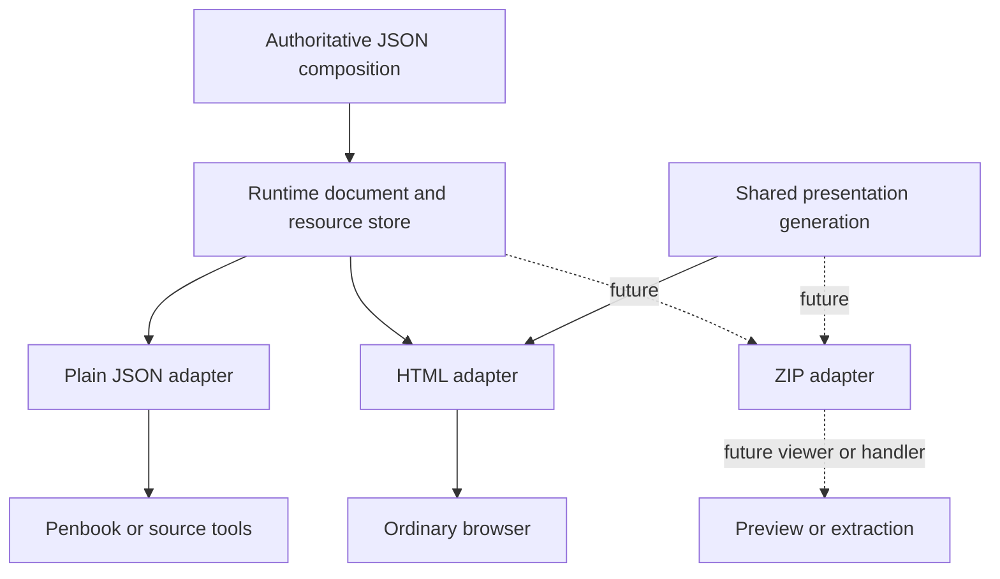

| Format | Role | Main implications |
|---|---|---|
| Clean JSON | Baseline model, development/debugging/source editing and supported local save/open format. | Text source is easy to inspect. A source-only document referencing absent assets cannot render those assets; an asset-bearing self-contained JSON encoding must separate composition from binary payload logically. |
| HTML (`.html`) | Primary everyday portable document, viewable without Penbook. | Inert authoritative JSON, generated presentation, embedded resources and only required viewer logic. External source edits can leave the saved representation stale. |
| ZIP (`.penbook`, tentative) | Possible future asset-efficient single-file package. | Standard archive can access individual entries; separate native binary resources, JSON and preview HTML. Not directly viewable as a composed document by ordinary browser/Explorer without appropriate support. |

The JSON composition must work regardless of whether it is embedded in HTML and regardless of the condition of the generated presentation. Where assets are required, the format adapter supplies them to the common resource store. Decide the exact plain-JSON encoding in the prototype; support simple asset-free JSON as ordinary readable source, plus an explicit resource payload mechanism for image-bearing JSON round-trips. Do not inline binary data inside individual block payloads merely for convenience. Schema and envelope are allowed to evolve freely during the experimental phase.

### 11.2 HTML envelope and regeneration

**Established design intent; exact physical encoding provisional.** Structure the saved document for selective access and reliable standalone viewing. A short identifying header/instructions should be easy to inspect before encountering large binary data. Use stable, clearly delimited inert sections, with the authoritative composition source near the beginning. The format experiment used `script#document-source`; this is a useful initial convention, not a permanent compatibility promise.

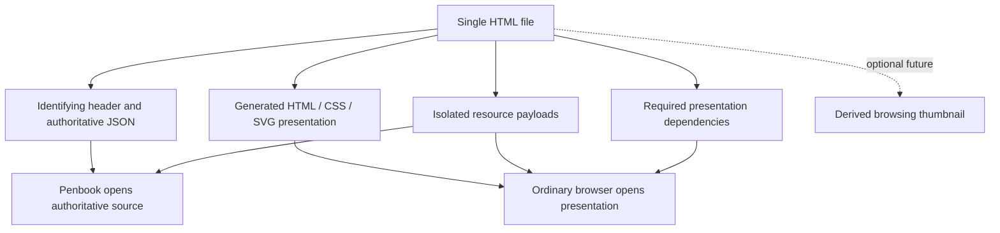

Resources may be placed in a dedicated payload section toward the end. The composition references resource IDs, not giant Base64 strings. Preserve original bytes and MIME information. Avoid storing the same binary resource twice between source and presentation or once per block usage. A small trusted resource resolver or an alternative single-storage HTML mechanism may be necessary; choose the simplest reliable approach and test it with `file://`, offline and multiple references. Resource bytes can be encoded in Base64 for HTML (approximately 33% encoding overhead before other costs). Avoid duplicating huge strings in memory and rendering caches unnecessarily. Avoid including all application dependencies in every document. Correctly escape embedded JSON (including `</script>`-like sequences), SVG, text and attributes; do not treat source as executable code.

On open, Penbook reads authoritative source and resource sections, validates, and renders a fresh in-memory document. It must not use saved presentation markup to infer authored content. On save, write the updated source and freshly generated presentation together. If an external agent edits only the JSON, a plain browser may still display the previous saved representation until Penbook regenerates and saves it. This is an accepted consequence of separating source from representation. A missing, stale or deliberately removed presentation must not prevent reconstructing valid source with its resources. Do not silently overwrite the disk file simply by opening it; regeneration of the saved view occurs on explicit save or controlled autosave. A stale indicator/fingerprint and explicit regenerate command are useful candidates, not mandatory elaborate infrastructure.

A reader-facing export may eventually omit the editable source if desired, but a normal Penbook HTML document contains both source and representation. Exporting a presentation-only copy must not be confused with saving the editable document. Source disclosure remains inherent for any data/script included for runtime interaction.

### 11.3 Why not decide ZIP forever now?

ZIP is not inherently slow. Standard archive entries can be accessed selectively, and already compressed assets can be stored without additional compression. Word's opening delay cannot be attributed solely to the archive container. ZIP could contain root `document.json`, `assets/`, generated `preview.html` and optionally `thumbnail.webp`. A reader need not inflate every asset to access the source or thumbnail. How the HTML preview inside an archive references assets, and how fast extraction/saving would be, are future design questions.

The trade-off is immediacy: ordinary browsers do not natively present a custom ZIP as a Penbook document. Windows Explorer thumbnail and preview handlers or a QuickLook plugin are technically possible but need a separately installed native integration; a PWA cannot register them itself. PowerToys Peek and ordinary archive previews do not automatically render custom Penbook compositions. Native integration is not a deal breaker if Penbook later becomes valuable enough to justify it. Verify current platform capabilities before undertaking such work. Do not make native handlers a prerequisite for the initial application.

A later ZIP experiment should compare actual app open/save/first render, random access, memory, file size, standalone/preview experience and agent editing using matched fixtures and documented hardware/browser/tool conditions. No presumption that one format is categorically faster. ZIP is optional, not a predetermined milestone.

### 11.4 Resource policy: storage versus behaviour

**Established conceptual model.** Embedded resources are the default. Resource storage and update behaviour are independent dimensions. Policies can be inherited and overridden at application/install level, document level and individual resource/block level as appropriate. The effective choice must be explicit and inspectable. Module-specific resource behaviour may be appropriate, but use shared access/storage services.

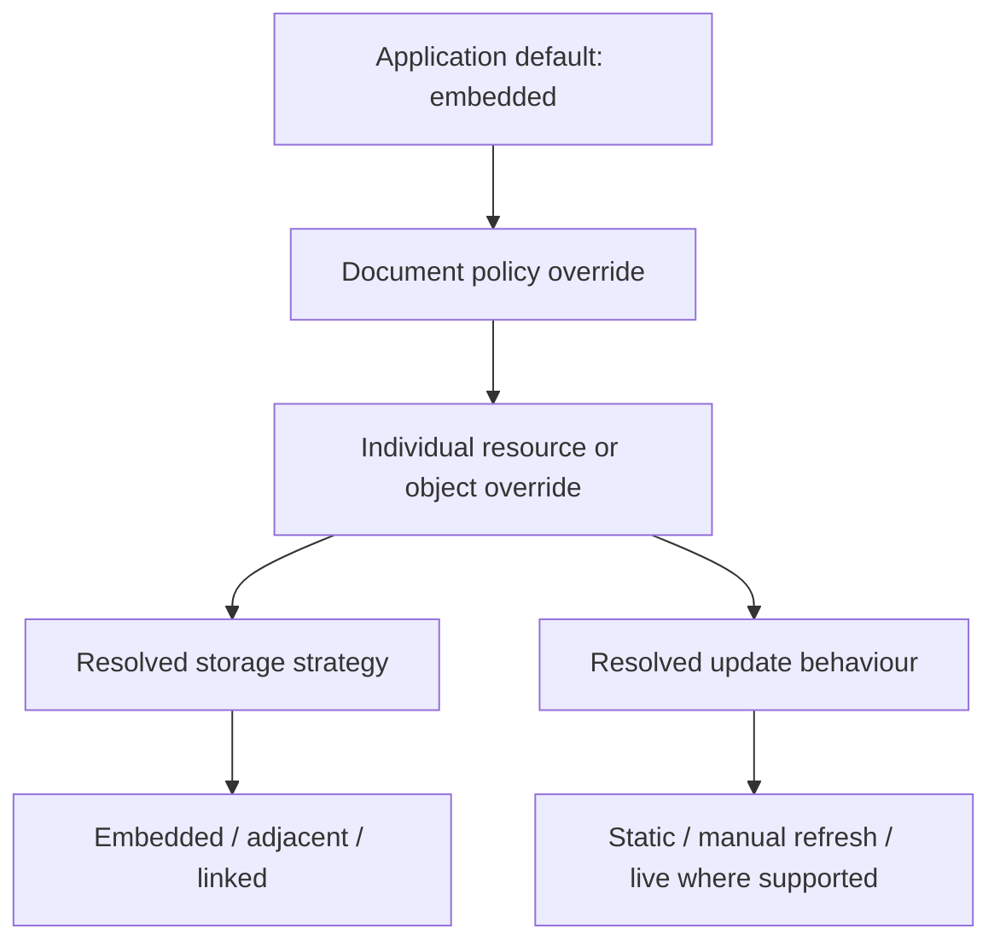

| Storage strategy | Meaning |
|---|---|
| Embedded | Independent copy inside the document; default and only initial Prototype 01 storage strategy. |
| Adjacent | Independent copy next to the document, potentially in a resource folder; copy if needed, prefer portable relative paths and avoid duplicates. Deferred. |
| Linked | Reference to existing resource without copying. Advanced/deferred and only when browser permissions make the workflow viable. |

| Update behaviour | Meaning |
|---|---|
| Static | Use saved resource or authored snapshot until explicitly replaced. |
| Manually refreshed | Retain source reference and update when user requests it. |
| Live where supported | Follow resolvable external changes with a well-defined policy. Not a promise of unrestricted filesystem watching. |

A linked architectural SVG might keep an embedded snapshot and refresh manually; an image might display the latest authorised external file; a parametric block might link a script and regenerate when requested. A snapshot is a fallback/presentation of the resource, not necessarily a second independent authoritative copy. If a deliberately embedded resource has an external origin, retaining provenance does not imply it automatically updates.

Changing a default should affect new resource additions, not silently relocate or delete existing resource bytes. Moving resources between storage strategies should be explicit, with validation of dependencies and permission. Deduplicate embedded binaries within a document (content equality where practical, stable resource IDs). Several blocks can reference the same resource; copy/duplicate semantics should preserve sharing when suitable. Manage resource lifetime, references, history, orphan cleanup and MIME/metadata. Exact content hashing, reference ownership and garbage collection are open; avoid destructive cleanup during early development.

### 11.5 Browser filesystem constraints

A PWA cannot access an arbitrary local path because a document mentions it. Opening a file grants access to that file, not all of its siblings or external references. A granted folder permits access to files within its scope subject to browser permissions. File handles may be remembered, but authorisation may need renewal. An installed PWA does not remove the sandbox. Explicit permission or selection is needed for other paths. Relative paths make references portable but do not bypass permissions.

Consequently, arbitrary linking should not be a dependency of daily use. Embedded assets first; adjacent/linked resources only if later workflows are sufficiently frictionless. For a linked source, handle unavailable permission, missing file, stale snapshot, changed path and manual relinking clearly. Prefer meaningful fallback output in standalone documents. Linked-only files cannot promise complete offline portability. A self-contained export must embed or otherwise include everything necessary, or explicitly report what cannot be included. No silent network retrieval of local or remote resources.

### 11.6 Local files, saving and organisation

**Established.** Authoritative documents live in user-controlled files, not IndexedDB, localStorage or a remote service. Application settings, saved presets, remembered file/folder handles and optional disposable caches/recovery state may use browser storage. A cached PWA shell supports offline application use; cached documents must not become a second authoritative store.

Target Chromium File System Access for open/save/save-as and a granted folder explorer with direct read/write. Use ordinary picker/import and download fallback where practical. Respect permission denial, cancellation, read-only handles and save errors. Keep dirty state; do not silently lose edits when switching documents. Explicit save is foundational; autosave may be introduced when it can reliably flush completed edits and handle errors. Do not rely on asynchronous saving at window close. External edit/conflict handling should protect the user's file; exact conflict/revision detection and recovery strategy can evolve. No forced document migration while testing.

Organisation should remain lightweight: browse folders and filenames, basic sort/search, metadata/tags where useful, document/page navigation. Chronological journal browsing across documents/pages and richer galleries may emerge later. Sourcebook can provide broader file indexing and generate its own previews. No mandatory global notebook hierarchy or asset database. A physical folder is not necessarily a Penbook document. Document boundaries are the user's choice.

### 11.7 Three meanings of preview

Do not conflate these:

1. **Actual document preview:** the generated viewable HTML is the principal preview, including meaningful content and optional intended interactivity. Immediate reading via browser/Peek/Explorer-like side preview matters more than thumbnails for the intended workflow.
2. **Browsing thumbnail:** a small representative image or selected portion of the document. If implemented, generate/refresh it on save and store it in an identifiable section in HTML or a dedicated ZIP member. An app such as Sourcebook that understands the convention can retrieve it without rendering all documents, but Sourcebook may instead generate its own preview. A thumbnail is derived, not authoritative. It need not depict the whole board or page sequence.
3. **Native OS preview/thumbnail integration:** separate platform-specific support, not a property automatically obtained by embedding an image. Defer native handlers and thumbnail work. HTML can benefit from existing HTML-aware viewers, but specific application behaviour must be tested.

Browser DOM-to-image capture is not a universally straightforward native API; rendering a reliable thumbnail may need a module-aware strategy or justified library. It is not a high-priority prototype feature. If browsing a large folder later, avoid fully opening/rendering hundreds of documents for tiny previews; lazy loading, caching and bounded memory should be considered.

### 11.8 Selective and agent-friendly source access

**Established requirement.** Agent manipulation is a normal workflow, not an afterthought. Ordinary file access should allow an agent to inspect a few relevant fields/blocks without consuming all embedded images, generated markup or resource metadata. Reading bytes locally in a program does not itself consume model tokens; returning unnecessary bytes to the model does. Tool truncation is not a guarantee against wasted context or a reason to print large files.

For HTML, use a short identifying comment/header and a predictable source marker (initially `script#document-source` if the format tests' convention is retained). Put authoritative composition before large payloads; isolate binary resources and generated output. Use formatted, readable JSON where practical. Extract the relevant JSON locally, parse it with a proper parser, output only necessary fields, make a structured edit, safely encode/replace the source, and verify that unrelated sections and assets are preserved. Do not read the entire file into model context, rewrite generated presentation as if it were source, or use fragile textual replacement of arbitrary JSON fragments. External source edits need not regenerate presentation: Penbook regenerates on open/save.

A convention and embedded instructions improve an unfamiliar agent's chances of acting correctly, but cannot guarantee its behaviour. It might still request the whole file. ZIP provides a stronger physical boundary for selective source access (open the known `document.json` member without reading images); even there an agent could unnecessarily list or inspect resources. Do not assign percentages without controlled testing.

An optional small local toolkit could eventually provide `inspect`, `read`, `validate`, `extract-assets` and `regenerate` commands or an agent skill. This is a convenience, not a requirement for the file to be editable. The later benchmark workflow deliberately removed a mandatory Python regeneration helper: agents edit authoritative JSON and preserve the old preview, and the application refreshes it. Do not reintroduce required external tooling or a server. If a headless rendering path is later useful, share rendering logic with the application rather than maintain an independent renderer. Exact distribution and interface remain open.

For a future ZIP convention, use standard archive tools, open root `document.json` directly, preserve untouched entries (names and contents, order where practical), repackage without an enclosing directory, verify changes before replacing the original. Never require an agent to decompress image binaries into its textual context. Keep general local-machine `AGENTS.md` guidance short; a format-specific instruction can be more precise. The application repository's `AGENTS.md` is developer guidance and should not be bloated into a complete format manual.

### 11.9 Format benchmark: actual observations

Source: *Penbook editing benchmark.md*, 28 November 2026, supplied in the related format discussion. Each run used one prompt with GPT-6.2 Sol at low reasoning effort. Values are reported workflow observations, not repeated controlled statistical measurements. Final context is input to the last model call; total tokens include cached input and summed usage across the turn. The same requested content edits were performed, but placement, verification and tool calls differed.

| Observed run | Size / images | Time | Shell calls / failures | Total tokens |
|---|---:|---:|---:|---:|
| Linked Markdown 4 (external image links) | 10.1 KB / 81 | 19.66 s | 2 / 0 | 77,913 |
| HTML 1 | 0.77 MB / 2 | 21.63 s | 2 / 0 | 91,169 |
| HTML 2 | 10.58 MB / 32 | 34.08 s | 3 / 0 | 117,847 |
| HTML 3 | 43.53 MB / 81 | 62.07 s | 4 / 0 | 178,902 |
| HTML 5 (local guidance) | 43.53 MB / 81 | 66.65 s | 4 / 0 | 154,219 |
| HTML 6 (prompt + local guidance) | 43.53 MB / 81 | 29.98 s | 2 / 0 | 86,890 |
| ZIP 1 | 0.58 MB / 2 | 44.10 s | 4 / 1 | 119,552 |
| ZIP 2 | 7.94 MB / 32 | 43.47 s | 4 / 1 | 135,143 |
| ZIP 3 | 32.68 MB / 81 | 30.03 s | 3 / 0 | 107,970 |
| ZIP 5 (local guidance) | 32.68 MB / 81 | 34.04 s | 3 / 1 | 118,204 |
| ZIP 6 (prompt + local guidance) | 32.68 MB / 81 | 23.94 s | 2 / 0 | 88,196 |

HTML 6 and ZIP 6 both preserved generated preview and images. The fastest guided self-contained edit was ZIP 6; HTML 6 was close in elapsed time and consumed slightly fewer total tokens in those particular runs. Whole-file HTML reads had hit truncation in earlier runs; local guidance alone did not guarantee fast editing. ZIP 1 required format detection and a failed replacement retry; ZIP 5 had a raw text editing failure before using parsed JSON. ZIP 4 was excluded in the source benchmark because the preview was changed despite the revised workflow. Linked Markdown is useful context but not a self-contained comparison. The approximately 43.53 versus 32.68 MB size difference is consistent with Base64 overhead; these are the tested fixtures, not universal ratios.

Conclusions to retain: narrow inspection, parsed source edits, preservation of untouched content, and fewer shell/model round-trips matter. The benchmark does not prove ZIP is categorically faster, HTML is safe against uninformed agent reads, or either app implementation meets daily opening performance goals. In the later format discussion the user explicitly selected HTML for its ordinary browser viewing and convenience. App-side opening/rendering concerns remain important; exact app-side benchmark figures were not available in the material reviewed for this document, so no numerical claims about them are made. Repeat representative tests when the real engine exists.

## 12. Exports and interoperability

**Established principle:** distinguish saving an editable document from generating a derivative artifact. Keep the composition source intact and do not make export-specific requirements dictate a separate authoritative structure. Export can be document-wide, selected container/frame, selected pages or another explicit boundary depending on the format.

| Output | Intended role and maturity |
|---|---|
| Editable HTML | Primary file and self-contained presentation, established. Contains source and necessary resource/viewer dependencies. |
| Clean JSON | Independent editable source/format, established. |
| Presentation-only HTML | Possible future sharing/export without authoring payload where feasible; any data required by interactive presentation remains inspectable. |
| SVG | Vector block export, fixed frame/board composition where meaningful. SVG is one document, not a native multi-page viewer; page-specific outputs may be generated individually. Mixed HTML content may need conversion, so exact fidelity strategy is open. |
| PNG/WebP/JPEG | Raster output of a sketch, selected frame or rendered composition; transparency, scale, quality and dimensions should be explicit. |
| PDF / print | Fixed pages, sheets, report and presentation sequences. Browser print can be an initial experiment; accurate page sizes, pagination, fonts and vector fidelity need later work. |
| Markdown | Lightweight text-oriented derivative. Include an option to export Markdown with links to existing assets rather than saving copies of images to disk. Preserve meaningful reading order; identify or report nonrepresentable blocks and embedded-only resources without a valid external path. Other Markdown asset/export strategies are open. |
| Presentation exchange (e.g. PowerPoint) | Possible later derivative; no promise of editable fidelity or engine now. |
| ZIP package | Deferred alternative storage/packaging, not required export for current prototype. |

Interoperability should use stable identities, ordinary media, compatible composition grammar and explicit references. Future examples include copying an editable presentation composition to Website Builder, importing a published/linked Archbook view with an embedded snapshot and manually refreshing it, including a model viewer in a research note, and browsing Penbook through Sourcebook. No requirement for shared repositories, central database or direct module-to-module computation. Do not force the entire app family into a common schema before concrete interoperability tests justify it.

## 13. Technology, performance and quality

### 13.1 Technology direction

| Area | Status and direction |
|---|---|
| Deployment | **Established:** browser-only, local-first installable PWA, static hosting, offline shell. No permanent server, remote DB or mandatory account. A development server/build tool is not an application backend. |
| Initial platform | **Established:** desktop Chromium, File System Access where supported; progressively consider touch/pen and other browsers, with picker/download fallback. |
| Language/rendering | **Preferred:** ordinary JS, HTML and CSS; native DOM/Flexbox/Grid/positioning, Canvas/SVG/WebGL as appropriate per module. Use a small build tool such as Vite if useful, not a requirement to use a specific framework. |
| Data | **Established:** thin JSON composition and native content payloads; runtime ordinary JavaScript data, resource bytes handled as Blob/ArrayBuffer or suitable structures. No database needed for documents. |
| UI | **Preferred:** lightweight shared visual language, contextual commands and panels. Framework choice open; reuse of UI helpers only when appropriate. No need to import the Sketchnote React shell or Graphic Pad single-file implementation. |
| Content libraries | **Open:** Markdown parser/editor, SVG sanitiser/graphics library, raster encoding, gallery implementation and future 3D/kernel packages. Choose according to each module's actual requirements, licence and offline behaviour. |
| Serialization | **Established boundary, open details:** JSON and HTML initially; resource encoding/resolution, parser, safe escaping, format markers and storage schema experimentally chosen. ZIP later if justified. |
| Test strategy | **Established:** model tests and real browser tests, sample documents, explicit acceptance cases; manual hardware tests where necessary. Exact libraries/tooling open. |

Use native capabilities rather than reinventing them, but do not let convenience libraries dictate the fundamental document architecture. A small justified dependency can be preferable to maintaining a complicated bespoke implementation. Avoid unnecessary framework coupling, giant speculative abstractions and importing code from unrelated repos. Track dependency licences and include redistribution requirements for self-contained output. The initial application does not require a WASM kernel, Node server, cloud backend or native extension.

### 13.2 Performance as product behaviour

**Established goals:** ordinary notes open/save with very little perceived friction; selection, dragging, typing and navigation remain responsive; no heavy runtime in every file; large collections/resources are handled without making small notes expensive. A small document should remain small. Big computational documents may legitimately be bigger or slower, but they should not impose their costs on all documents.

Investigate selective resource decoding, lazy mounting for large compositions, bounded caches, resource deduplication, worker encoding, efficient history, stable block DOM and targeted updates when needed. Defer thumbnail machinery and sophisticated virtualisation until scale demands it. Avoid rebuilding all content on every change. A measured bottleneck is a better reason for a performance mechanism than a theoretical future requirement.

Record actual open (read/parse/render), save (serialization/write), representative layout conversion and interaction performance, source/asset sizes and memory if practical, using named fixtures and known browser/hardware conditions. Repeated measurements and matched fixtures are preferable. No numerical latency guarantee has yet been agreed; derive realistic budgets from Prototype 01 and subsequent usage. A source-only Node test is not evidence of native file-picking, PWA behaviour or physical pen responsiveness.

### 13.3 Reliability, accessibility and security

Validation must be explicit: unique IDs, permitted container children, valid supported layout/extent values, sane geometry, reference integrity, module payloads, resource availability and safe source encoding. Invalid edits must not silently overwrite the last valid state. Unknown content should be preserved even if it cannot yet be rendered; unsupported critical structures can be refused with diagnostics. Derived presentation cannot substitute for missing authoritative source. Report partial results and limitations, not fake success.

Use meaningful semantic HTML for text, alt text, reading order and keyboard interactions where possible. Visual stacking order is not automatically accessible reading order. Keep source and viewer execution inert or isolated as appropriate; avoid executing imported SVG/script and making unrestricted filesystem/network calls. Do not claim a fully hardened parser or sandbox without testing. Consider large payload limits and resource exhaustion as the system evolves.

File-first reliability does not mean every format must be production-ready during exploration. Protect current test files from accidental destructive writes, but do not accumulate compatibility code for obsolete test schemas. Data integrity, validation and meaningful undo are useful from day one; migrations and long-term backwards compatibility become obligations only after the deliberate transition to durable real documents.

## 14. Decision register and unresolved matters

This register is a concise index of the decisions above. It is not an implementation checklist. Revisit open decisions only when relevant to actual development.

### 14.1 Established decisions

| ID | Decision |
|---|---|
| E01 | Equal standing of text, sketching, visual research, boards, graphics, layouts and presentation; local-first personal tool, not a publishing CMS or CAD dataflow platform. |
| E02 | Fresh independent Prototype 01 based on JSON direction; A/B experiments are disposable references, no schema/code inheritance. |
| E03 | One authoritative JSON composition, native payloads, independent storage formats and generated visual representation. |
| E04 | Single root container; all compositional objects blocks; only containers have compositional children; atomic modules may own rich internal structures. |
| E05 | Independent extent on X/Y, layout, sizing, placement, structural/draw order and view; nested layouts and overlap; preserve content/IDs through conversions. |
| E06 | Modules own their content, internal UI and presentation; core owns composition/common services; registries rather than inter-module graph or messaging. |
| E07 | Live visual document, source access and preview; static presentation by default, optional module-defined interactivity without write-back. |
| E08 | Persistent composition/content modes; entirely contextual tools, common toolbar/properties/module panel/commands. |
| E09 | One chronological document history; meaningful module transactions, separate transient state, avoid broad unrelated rerenders. |
| E10 | One preset configuration structure: app library, saved document snapshot, active editable configuration; opening activates document preset; explicit save destinations and creation choices. |
| E11 | Presets control defaults and work behaviour, not automatic restructuring of existing content; explicit layout operations. |
| E12 | Stored versus effective properties; authored versus resolved/generated structure; stable IDs and explicit references. |
| E13 | Styles as named properties; templates independent copies; components linked reusable subtrees; galleries range from manual to module-owned to generated compositions. |
| E14 | Raster sketch and vector graphics are distinct modules; full Graphic Pad and core Website Builder compositional capabilities are long-term targets. |
| E15 | HTML primary everyday format, clean JSON independent; ZIP deferred. Self-contained HTML bundles only required presentation logic and resources. |
| E16 | Embedded assets default; adjacent/linked options conceptually available subject to browser permissions; storage and update behaviour independent; overrides at app/document/resource levels. |
| E17 | Isolate heavy payloads, avoid duplicated binary data, enable narrow agent edits, regenerate presentation from source on open/save. |
| E18 | Actual readable preview matters more than thumbnail support; native preview handlers and embedded thumbnails deferred. |
| E19 | Browser-only offline PWA, desktop Chromium first, documents in ordinary files, no permanent app server or database. |
| E20 | Engine-first, module functionality developed deliberately; no permanent-value documents or backwards-compatibility obligations during exploration; adaptive prototypes, no fixed roadmap. |

### 14.2 Provisional approaches and open questions

| Area | Present approach / question to resolve |
|---|---|
| Exact schema, identity and indexing | Keep simple JS/JSON objects; choose field names, type discriminators, ID scheme, versioning, resource/index representation and reference rules in real prototypes. |
| Spatial semantics | CSS px logical units preferred; determine axis sizing dependencies, units, grid convention/track flexibility, aspect ratios, clipping, negative coordinates, proportional scale versus reflow. |
| Conversion and interaction | Deterministic spatial-to-flow order; how to retain placement histories, reparent geometry, handle covered blocks, nested multi-selection, resize behaviour and snapping. |
| Module interface | Small registry contract; exact lifecycle, properties/commands declarations, transaction payloads, render/update mechanism and preview reuse still open. |
| Text | Markdown authoritative preferred; live Markdown versus formatting toolbar/source toggle, rich-text losslessness and editor library not settled. |
| Graphics/raster | SVG or native scene + derived SVG; raster encoding and efficient binary history; how internal view interacts with outer view; exact capabilities after module-specific design. |
| History | One timeline agreed; snapshots/patches/inverse commands, gesture coalescing, memory budget and persistence open. |
| Presets | Shared configuration model agreed; exact schema, general settings precedence, tool defaults, preset editing UI and template behaviour open. |
| Reuse | Property resolution order preferred; styleability, definition scope, instance overrides, slots, identity resolution, generated materialisation and cross-document libraries open. |
| Collections | Typed query approach preferred; record model, binding rules, grouping, metadata scope, cross-document sourcing and gallery subtypes open. |
| Format encoding | HTML source marker, asset payload layout and deduplicated standalone resolution; JSON resource encoding; optional stale marker and regenerate UX; no frozen format. |
| Large resources | Base64 overhead accepted initially; efficient memory and streaming/selective read/write, content hashes, orphan cleanup and asset strategy conversion open. |
| File workflow | File picker and granted folder; autosave timing, external conflicts, permission renewal, remembered handles and fallback details open. |
| Previews | Representative in-file thumbnail if useful; native handlers and ZIP preview experiment deferred. |
| Agent tools | Narrow access required; optional toolkit/skill, standalone regeneration path and instruction delivery open; no mandatory helper. |
| Advanced presentation | Trusted built-ins vs untrusted scripts; dependency manifest, WASM/worker embedding, sandboxing and licences to be evaluated with actual modules. |
| Exports | Print/PDF fidelity, SVG mixed content, raster scale and Markdown mapping, presentation exchange and external resources need separate design. |
| UI and inputs | Contextual structure agreed; exact layout, dock/floating controls, shortcuts, touch/pen behaviour and mobile support evolve. |
| Stack | Vanilla web preferred; no forced framework or library selection; justify actual choices. |
| Transition to durable use | Explicit future decision needed before real documents depend on compatibility/migrations. Criteria and migration policy not yet defined. |

## 15. Reference material and evidence limits

Use these references as design context. Do not copy their schemas or implementations without explicit justification, and do not modify their repositories as part of Penbook development.

| Reference | What to learn |
|---|---|
| *Graphic Pad Specification Review* (26–27 Nov 2026) | Penbook synthesis, recursive blocks/containers, extent/layout/view independence, presets, original use cases. |
| *Compare Penbook Architectures* (27–28 Nov 2026) and continuation discussions | Authoritative JSON selection, clean foundation, modular contracts, spatial overlap, contextual modes, presets, resource strategies, long-term capabilities and decision maturity. |
| *Penbook — A/B Prototype Brief* (`penbook-ab-prototype-brief.md`, 27 Nov 2026) | Historical common behaviour, scope, test matrix and reference material. Superseded as an implementation brief; its broader use cases remain informative. |
| [Penbook A](https://github.com/teodor-andonov/261114_testlab/tree/main/261127_penbook-a) / [Penbook B](https://github.com/teodor-andonov/261114_testlab/tree/main/261127_penbook-b) | Disposable experiments. Previously inspected code/docs, not an audited production base. |
| *Compare Penbook Formats*, *Compare HTML ZIP Formats* and *Penbook editing benchmark.md* (27–28 Nov 2026) | Agent/source-only editing, separate preview, embedding, HTML/ZIP trade-offs and final HTML preference. |
| [Website Builder](https://github.com/teodor-andonov/ta-website-builder-261012), especially [architecture](https://github.com/teodor-andonov/ta-website-builder-261012/blob/main/docs/POST_V1_ARCHITECTURE.md), [grid notes](https://github.com/teodor-andonov/ta-website-builder-261012/blob/main/docs/M7_PRINT_GRID.md), and [asset-query galleries](https://github.com/teodor-andonov/ta-website-builder-261012/blob/main/docs/logs/2026-10-16-m15-asset-query-galleries.md) | Recursive Cards/Items, explicit grid areas, structural vs visual order, fixed/aspect and auto rows, shared renderer, styles, components/templates, asset metadata and typed queries. Its print-like scaling is not automatically Penbook's scaling rule. |
| [Graphic Pad](https://github.com/teodor-andonov/261028_gaphic-pad) | Infinite board and frames, SVG scene, object-level graphical editing and exports. Full current source not audited; scope exact parity later. |
| [Sketchnote PWA](https://github.com/teodor-andonov/261127_sketchnote) | Natural raster drawing; inspect README, canvas tools, `CanvasHost.tsx`, history and files code for practical mechanisms. Earlier Obsidian-specific plugin is a historical reference. |
| [HTML Notes](https://github.com/teodor-andonov/261114_testlab/tree/main/261118_html-notes) | Native web payloads, embedding and source editing. |
| [Graphic Design System](https://github.com/teodor-andonov/ta-graphic-design-system) | Shared visual language, tokens and compositional ideas. |
| [Archbook](https://github.com/teodor-andonov/261126_archbook) | File-first architectural project model, views, identities, source/output distinction and possible future exchange. |
| [Mindmap](https://github.com/teodor-andonov/261019-1740_pwa-mindmap) | Semantic graphs and automatic layouts. |
| [Sourcebook](https://github.com/teodor-andonov/261116-2133_sourcebook-7-pwa) | Filesystem organisation, tags, galleries, permissions and independently generated previews. |
| [Testlab](https://github.com/teodor-andonov/261114_testlab) | Prototype conventions, static deployment and shared UI guidance if development takes place there. Read current guidance, not an old assumption. |

This synthesis draws on the extended founding conversation, recovered related chat decisions, the original A/B brief, the supplied editing benchmark and the earlier inspections of related repositories. It does not claim complete transcription of every earlier chat, new hardware/runtime testing or a comprehensive code audit of every reference. Some future design details are intentionally marked open. Where historic instructions conflict with the current decision (A/B feature scope, linked template terminology, file format preferences, compatibility or a fixed roadmap), the latest agreed direction takes precedence.
