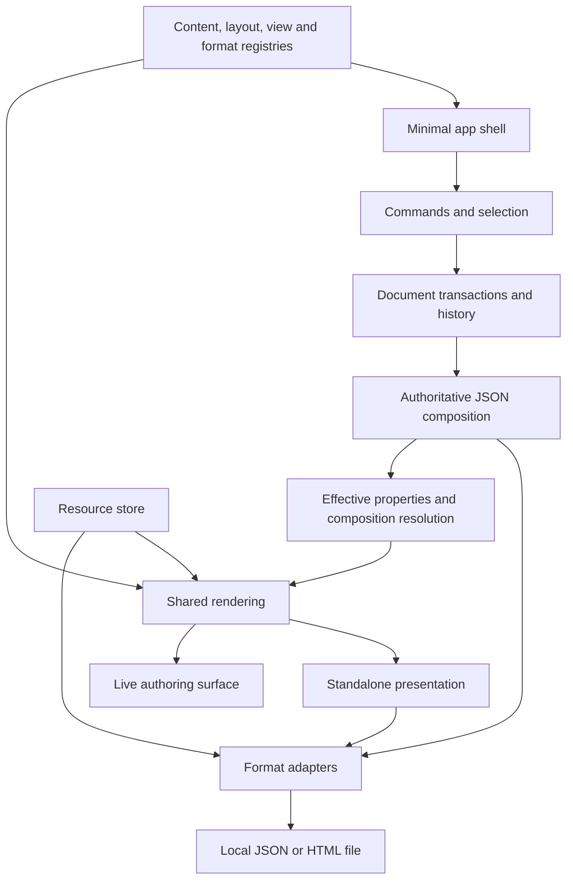

# Penbook — Prototype 01: Foundation

**Status:** Implementation brief · 28 November 2026  
**Development phase:** Experimental / disposable documents  
**Companion documents:** [Vision](PENBOOK_VISION.md) · [Architecture](PENBOOK_ARCHITECTURE.md) · [Agent guidance](AGENTS.md)

## 1. Purpose and scope authority

Build the first proper Penbook prototype: a small, working, independently implemented foundation for a modular, file-first composition application. The purpose is to validate the document engine, architectural boundaries, spatial behaviour, editing model and persistence before developing sophisticated individual content modules.

The earlier A/B tests settled the high-level direction: authoritative JSON with native payloads and derived visual output. **Do not build on either experiment.** Do not migrate their code, file formats or superficial content implementations. They and the related applications are references only. This prototype is an opportunity to establish a clean foundation rather than repair a feasibility test.

Read the [Vision](PENBOOK_VISION.md) and [Architecture](PENBOOK_ARCHITECTURE.md) for the full context. The architecture contains many intended future capabilities. It is not a backlog. This brief controls current scope. No advanced feature should be implemented merely because it appears in the architecture. Flag decisions that affect the agreed architecture; choose simple, reversible implementation details where the architecture leaves them open.

All prototype documents are disposable test material. The schema, APIs and storage envelope may evolve freely. No backwards compatibility or legacy migration requirements. Nevertheless, the currently supported format must be safe to edit, save and reopen, with explicit validation and failure handling.

## 2. What success looks like

A user can open a real local Penbook document, work directly on its rendered content, arrange and nest simple blocks under several different spatial rules, switch between composition and content editing, use one undo/redo history, change presets and views, and save/reopen the result. HTML output is independently viewable offline in an ordinary browser. The JSON source can be inspected and edited without the generated HTML or binary resources becoming the authority.

A developer can add a small new content type through a registration and module implementation without rewriting the core, format adapters, main render switch or global inspector. The engine can handle a text note, a board, a fixed architectural sheet, a paged notebook and a nested mixed composition with the same underlying model. The architectural decisions are visible in real working code and tests, not merely directory names and diagrams.

Prioritise engine and architecture over interface polish (roughly an 80/20 emphasis, not an effort quota). A clean usable shell is required; advanced drawing, vector, galleries, reusable component systems and publishing workflows are not.

## 3. Delivery boundaries and initial stack

- Browser-only, local-first, file-first; no application backend, account, remote database or persistent browser document store.
- Target desktop Chromium. Build a static, installable/offline-capable PWA application or, if hosted within Testlab, use its supported PWA shell without conflicting service workers/manifests. Cached application code is not a document database.
- Prefer ordinary JavaScript, HTML and CSS with native DOM/layout; use a small build tool and justified libraries where appropriate (e.g. Markdown rendering or SVG sanitisation). Record actual choices and trade-offs. No required framework, CAD kernel, Node runtime for document editing or external regeneration helper.
- Use actual local file open/save/save-as and a granted workspace-folder workflow. Provide picker/import/download fallback where practical. Do not substitute a browser-storage notebook or hardcoded demo states.
- The implementation target repository/folder has not been assigned in this brief. Use the location specified by the user or the task's repository context; if Testlab is chosen, create a fresh independent prototype folder according to its current conventions, not in either A/B directory. Read applicable `AGENTS.md`, avoid unrelated infrastructure changes and follow current build/version/publishing guidance. Do not infer a new repository or deployment permission from this document.

## 4. Required architecture and code organisation

The following diagram is a responsibility map, not a demand for a particular directory or class structure.

Suggested modules/folders (adjust to keep the code simple): `core/`, `content/`, `layouts/`, `views/`, `formats/`, `resources/`, `ui/`, `tests/`, `demos/`. Explicit registration is sufficient. Avoid framework-level plugin infrastructure, inter-module messaging, dataflow graphs, dependency injection systems or speculative generic type systems.

### 4.1 Authoritative model

Implement a small documented JSON schema with format identifier/version, document ID/title, optional basic metadata/tags, a root container, document preset/configuration and resource references. All compositional nodes are blocks with unique IDs; only containers own child blocks. Content blocks are atomic at the composition level. Distinguish common properties, parent-context placement, module-specific properties and module data. Use native content payloads wherever suitable.

Runtime JavaScript objects hold the authoritative document; binary payloads may be represented as Blobs or equivalent through a resource store. No second editable DOM model. Do not derive authoritative content by scraping the presentation. Distinguish explicitly stored values from resolved effective defaults even if the initial implementation only merges a small set of defaults. Keep authored structure separate from rendered/derived structure so later styles, components and generated compositions do not require a fundamental redesign. Stable IDs and a clear resource/reference model are required; a full component resolver is not.

Document current field semantics and schema examples in implementation documentation. Exact names and nesting are implementation decisions; the illustrative schema in the architecture is not binding. Validate IDs, tree structure, geometry, supported layouts/extent, module payloads and resource references. Preserve unknown content type data and display a safe placeholder; reject unsupported critical structures/invalid source with an intelligible error rather than silently discarding data. Do not build migrations for the discarded experiments.

### 4.2 Registries and module contract

Each content module should own its type ID, defaults, content validation, exposed properties, rendering, lifecycle/internal editing, contextual commands and static presentation. The core supplies scoped access to current block data, effective properties, region, mode, resource services and a transaction/commit interface. It hosts declared controls in generic toolbar/properties/module panel mechanisms. Module data changes participate in common history and dirty state. A module need not contribute a dedicated panel or support complex interaction if it has no need for them.

Register layout, view and format implementations behind small common interfaces. Layouts own immediate-child arrangement/placement, views own navigation/framing, and formats own encoding/decoding. Keep content-type checks out of generic block operations and avoid a central render or inspector switch that must grow for each type. Do not over-generalise these interfaces before their first actual consumers exist.

The authoring surface should remain mounted for unaffected blocks during ordinary edits. Use stable block IDs and targeted updates; do not recreate the entire rendered document on each property change or text keystroke. Clean up temporary editors, listeners and resource URLs on unmount. Full document mount on open or an explicit preview operation is fine.

Prove independence through a small registration smoke test (e.g. register a test-only content type with default data, a property, a basic editor/render function and static output). Demonstrate that generic insertion, selection, editing, serialization and export work without modifying the core. This is a test of the contract, not a fourth user-facing feature module.

### 4.3 State and history

Use one chronological document-level undo/redo stack. Model changes are meaningful transactions (e.g. one drag, one resize, one committed text edit, one source edit, one preset save-to-document). Validate and roll back failed operations; no partially applied invalid model. Undo/redo should restore relevant properties, hierarchy, identities and asset references and clear redo on a new edit. Selection, mode, camera and uncommitted input gestures are session/runtime state, not automatically saved authored changes. History persistence across sessions is not required.

A simple snapshot or patch strategy for small JSON is acceptable; do not duplicate large binary bytes per history entry. Keep resources alive while referenced by current state or undo. Do not introduce a second independent module history. Source editing and property changes must use the same transaction system.

## 5. Spatial foundation

Implement the following general capabilities, using native CSS where suitable. Exact controls may be simple numeric fields and commands initially; no advanced interactive layout designer required.

### 5.1 Independent extent and sizing

Support X/Y extent independently, with fixed dimensions, auto/content-driven sizing, responsive/available dimensions where meaningful, and an unbounded freeform working region. Support nested mixed constraints, e.g. fixed width + auto height or fixed sheet inside a board. Use CSS pixels as the initial logical unit unless a documented test demonstrates a better choice. Zoom is separate from document coordinates. Physical unit input and advanced proportional scaling can be deferred; demonstrate fixed paper-like dimensions numerically.

At minimum, child sizing supports fixed, fit-content/intrinsic and fill-available in meaningful contexts. Define and document fallbacks for ambiguous/incompatible combinations (e.g. fill available on an unbounded axis), rather than allowing sizing cycles. Use per-axis settings where useful. Include basic gaps/padding, alignment and container background/border and clipping control sufficient to exercise nested compositions. Aspect ratio or advanced units may be added only if needed for the demonstrations.

An unbounded board may use finite rendered content bounds with unrestricted practical pan/zoom. Support negative or otherwise offset positions with a documented coordinate policy; do not implement literally infinite DOM dimensions. Standalone output needs a finite, sensible content boundary with all intended content visible/reachable.

### 5.2 Layout modules

| Module | Required behaviour |
|---|---|
| Freeform | Explicit X/Y position, width/height and overlap; movement/resizing through direct controls and/or numeric properties. Optional rotation if straightforward, not a blocker for the foundation. |
| Flow | Vertical and horizontal arrangement; structural sequence, gap/padding, basic alignment, fit/fill/fixed sizing. Reorder children and reflow naturally. |
| Grid | Explicit row/column divisions, assigned cell areas/spans, gap/padding, basic child sizing. Multiple children may occupy overlapping cells or the entire grid. |

The parent layout controls external arrangement; modules own internal rendering. Structural order, grid/free placement and draw order are separate. Grid can use equal tracks and a simple documented index convention. Use native Grid/Flexbox/positioning, not a custom comprehensive CSS engine.

Enable explicit draw-order control for overlapping siblings, with deterministic tie-breaking. Demonstrate it using a transparent full-page SVG annotation over other blocks in a grid. Moving a block forward/back must not unexpectedly alter its structural order. Ensure covered content is reachable through the hierarchy even if pointer hit testing remains simple.

### 5.3 Layout conversion and structure operations

- Add/select, move, resize, reorder, reparent/nest/unnest, duplicate and delete supported blocks. Implement generic operations and appropriate validation. Single and multiple selection must work at least among siblings; arbitrary multi-parent selection policies may be deferred and documented.
- Preserve identity on move/reparent and create new IDs on duplication. Reject cycles and invalid destinations. Preserve shared resource references; remap any supported internal block references on duplicate. Do not silently lose content or assets.
- Convert a container among freeform, grid and flow. Use deterministic ordering/placement for conversions (e.g. row-major spatial reading order with stable tie-breaks). Retain prior freeform placement where practical and restore it on conversion back. Report approximation/loss explicitly and make conversion undoable. Verify a free → grid → flow → free round-trip.
- Change extent explicitly and support at least one fixed-to-content-driven conversion. Never automatically change a container's layout or authored dimensions simply because the view or active work preset changes.
- Use the hierarchy for precise selection, reordering and reparenting; direct manipulation on the surface for common operations. A first implementation may use commands/properties for complex grid spans and reparenting rather than polished drag interactions.

Basic duplication and in-document clipboard/transfer are useful. Full cross-document clipboard dependency remapping, sophisticated align/distribute/snap, selection cycling, advanced clipping and graphic transforms are not required now. Preserve architectural room for them.

### 5.4 View modules

Implement scroll, pan/zoom and paged navigation. Views operate on the same composition without rewriting its layout or content. Maintain camera/scroll/page index as runtime state, with saved default/preferred view in the document preset. Provide fit/overview or reset navigation where useful.

Paged navigation should use an ordinary sequence of fixed-size child containers, not a separate page document model. Navigate existing pages and create a new page using the document's creation template/default. A full-page simple SVG or text placeholder is adequate to demonstrate the future sketchbook workflow; no drawing module is required. Book spreads, slide transitions, thumbnail navigation and professional pagination are deferred.

## 6. Initial content modules: exactly three user-facing types

These modules exercise different content types and editing boundaries without pretending to be final implementations. Use straightforward behaviour and retain clear contracts so each module can be independently redesigned later.

| Module | Required in Prototype 01 | Not required |
|---|---|---|
| Text | Markdown as the initial native source; rendered headings, paragraphs, emphasis, lists and links; direct accessible content editing with immediate/near-immediate visual update, basic formatting commands and block-level source editing. | Full Obsidian-style hybrid live Markdown, complex WYSIWYG, advanced typography, tables/checklists if not provided by the chosen parser, complete Markdown editor. |
| Image | Import local image, embed original bytes through shared resource store, display with contain/cover/fill or equivalent, basic caption/alt and replacement. Properties available in composition mode; a simple content-mode replace/edit action demonstrates the contract. | Crop UI, filters, image editing, external links/adjacent asset policies, gallery functionality. |
| SVG | Import or author a safe SVG payload, render it in its allocated region, expose source replacement/editing and relevant basic display properties. Support transparency and full-page overlap in grid/freeform. | Vector scene editor, shape/arrow tools, layers, snapping, semantic diagram editing, raster drawing. |

Text should not require editing the document JSON for routine writing. The implementation may use a simple native editor with rendered output and a source/render toggle, or a modest in-place toolbar-driven approach preserving Markdown. Keep the main document visually rendered by default. A split editor/preview within an active block is acceptable for this first foundation if the inactive block and standalone output share rendering; record any visual differences. No separate permanent raw-text-only document interface.

Image and SVG modules must demonstrate safe resource/native-payload handling. SVG is a content type, not a new container. A page-sized transparent SVG can contain pre-authored annotations from a fixture and be editable at source level; do not implement a drawing tool just to demonstrate overlap.

All three modules provide static presentation. Use semantic HTML, ordinary image rendering and safe SVG. No interactive gallery or custom executable component in this prototype.

## 7. Interaction and minimal shell

### 7.1 Editing modes and shared rendering

Provide an explicit switch between persistent **composition mode** and **content mode**. In composition mode, pointer interaction selects/manipulates block geometry and structure; properties (including exposed module properties) are editable. In content mode, clicking a content block activates its internal editor and changes the contextual tools. Clicking another block switches active content without requiring repeated entry/exit of the global mode. Preserve edits when switching; avoid pointer events that move a block and edit it simultaneously. One active content editor is sufficient.

The main surface is the live rendered document. Provide a preview command/view without selection outlines, toolbars or authoring controls. Provide source inspection/editing at document JSON level and at relevant block payload level. Validate source changes before committing and keep last valid state on parse/validation errors. Large binary sections should not appear in normal JSON/source views.

### 7.2 Shell regions

Build a clean, minimal shell with the following regions (panels may share a physical sidebar):

| Region | Initial requirement |
|---|---|
| Document surface | Live content, selection affordances, basic resize/move and active view navigation. |
| Contextual toolbar | Mode/selection appropriate commands, text formatting when editing text, generic actions when composing. |
| Document hierarchy | Recursive tree, select/reorder/nest/reparent via simple controls; covered blocks selectable. |
| File explorer | Granted folder, simple listing and opening/saving real documents; demo access. |
| Properties | Common block/placement properties, layout/extent and exposed content properties; generic property declarations where practical. |
| Module tools panel | Optional slot for declared module-specific controls, distinct from generic properties; demonstrate with a simple contribution or test module. |
| Command palette | Search/execute registered available commands. Global and contextual operations share command IDs/actions rather than duplicated handlers. |
| Status bar | Active mode, view/zoom, dirty/save state, version and commit where supported by repository conventions. |

Allow panels to be independently shown/hidden through active configuration. No advanced docking framework, elaborate menus or polished responsive layout needed. Use a restrained, consistent visual style and keep the document dominant. Standard keyboard undo/redo, save and useful selection/navigation shortcuts should work without stealing text input. Mouse/keyboard behaviour must be tested; use pointer events with touch/pen suitability where practical. Physical pressure, palm rejection and dedicated mobile UX are not requirements for the initial modules; report actual device checks honestly.

## 8. Presets and creation behaviour

Implement the three forms of one simple configuration structure: built-in/user-saved application presets, a saved document preset snapshot and an editable active preset. Opening a document activates its snapshot by default. Creating a new document offers current active configuration, selected application preset or standard default. Save app presets in settings (not in the document database). Live active changes must not silently persist to either destination; provide explicit save-to-app and save-to-document actions.

Minimum configuration fields: preferred view, initial editing mode, panel visibility or basic shell configuration, defaults for newly created containers/blocks and new-document/page creation structure. Use ordinary block subtrees as simple creation templates; instantiate independent copies with new IDs. No linked reusable component system is required. Store the template/configuration needed for new pages with the document so it works after reopen.

Provide at least a standard default, text note, freeform board and paged notebook configuration. Fixed sheet/report presets may be added as part of the demo library. These are not document types. New documents and new pages use appropriate creation defaults; existing compositions remain unchanged when the user simply adjusts the active configuration. Explicit layout conversion/extent edits remain model operations. A future full sketchbook preset can create a raster sketch on each new page; here an available full-page SVG placeholder or text block exercises the mechanism.

## 9. Files, resources and standalone presentation

### 9.1 Two independent format adapters

Implement clean JSON and primary editable HTML. Both decode into the same logical composition and resource store. Neither imposes format-specific document features. A plain asset-free JSON document should be readily readable and editable. Define an explicit isolated resource payload representation for asset-bearing JSON round-trips so that opening/saving an image-bearing document in JSON does not silently drop images; keep composition fields and binary payloads distinct. Exact envelope field names are experimental. If a source-only export is also offered, label the missing resource dependency explicitly.

HTML contains the authoritative JSON source, resource payloads, generated visual representation and only needed presentation dependencies. Use an identifiable short header and stable source marker such as `script#document-source` near the beginning; keep binary data in separately identifiable sections. Store a resource once, even when used multiple times; do not duplicate it in JSON and generated markup. A small shared resolver for embedded assets is acceptable if necessary. Demonstrate that static text-only output is lightweight and does not carry the Penbook editor or unrelated module scripts.

The HTML must open in an ordinary browser offline without Penbook, remote fonts, CDN calls, a local server or a required external helper. Use safe native markup and source encoding. Test from actual saved files (`file://` where applicable), not just development-server URLs. Presentation interactions are static for these modules; there is no save-back capability. Do not execute arbitrary imported scripts; render only validated/sanitised supported data. Include any trusted asset-resolution runtime only if needed.

On opening, regenerate the in-memory representation from source, independent of the generated markup. On saving, regenerate the saved HTML. A plain browser may show stale output if an agent modified only the embedded JSON; document this behaviour and optionally show a simple stale indicator if inexpensive. A valid source and resource store must remain editable even when the generated presentation has been altered or removed. Missing authoritative source is an error, not a reason to treat the DOM as editable source.

### 9.2 Embedded resources only

Implement shared resource IDs, MIME metadata and embedded bytes. Preserve original bytes for imported images; reuse a resource referenced by several blocks, and deduplicate identical imports where straightforward. Avoid Base64 in per-block data, repeated binary storage in export or history, and dumping asset bytes in source UI/log output. Resolve images through the resource store and release transient URLs when no longer used. Validate missing assets; show a meaningful placeholder/diagnostic rather than crashing or silently deleting a reference.

Application/document/object storage-policy overrides, adjacent files, arbitrary linked paths, refresh policies and external reference snapshots belong to the long-term architecture, not this prototype. Do not implement a generic filesystem resolver for them. Preserve the distinction between source resource and its presentation.

### 9.3 Real file workflow

- Open JSON/HTML from local file picker; save and save-as to local filesystem, with dirty state and explicit error/cancellation handling.
- Open a user-granted folder, list supported documents, create/open files and save back through authorised handles. Remembered handles/preferences are optional; permissions may require renewal. No arbitrary path access.
- Protect the last valid in-memory state and avoid destructive writes on parse, validation or encoding failure. Do not silently discard unsaved edits when switching documents. Explicit save suffices; robust autosave/conflict recovery can evolve later. Avoid claiming atomic native replace guarantees that the browser cannot provide.
- Provide ordinary import/download fallback where feasible. Keep demos as actual editable files; never require a remote service to view saved embedded documents.

## 10. Demonstration documents

Produce five small, real, editable Penbook demo documents, preferably primary HTML plus at least representative clean JSON equivalents. All use original/synthetic or appropriately licensed local material. They must open, edit, save, reopen and export through the same engine; no hardcoded UI states, screenshots posing as documents or special document-type implementation.

| Demo | Composition and required exercises |
|---|---|
| 01 — Text note | Vertical flow, fixed or responsive width and auto height. Headings/lists/paragraphs, embedded image and optional SVG. Edit text, add/reorder a block, change sizing and open standalone HTML. |
| 02 — Moodboard | Unbounded freeform container with several images/text/SVG blocks, including overlapping objects. Pan/zoom, select/move/resize, change draw order, duplicate, convert free → grid → flow → free. Manual gallery only. |
| 03 — Architectural sheet | Fixed-size grid; multiple independent text/figure/image blocks and a transparent full-grid SVG annotation block above them. Verify overlap, draw order independent of tree order, covered block selection through hierarchy, spans, fixed extent and visual fidelity on export. |
| 04 — Paged notebook | Ordinary root sequence of at least two fixed-size child page containers; saved preset prefers content mode and paged view. Navigate pages and create another page from stored creation template, using a simple full-page SVG/text placeholder. Switch to composition and insert another block. Reopen and repeat page creation. |
| 05 — Mixed composition | Nested combinations of flow/grid/freeform with differing extents; e.g. responsive/auto outer flow, fixed sheet, nested grid and freeform container. Reparent and duplicate blocks, change view without altering content, test undo/redo and resource sharing. |

One additional synthetic stress fixture can be generated programmatically (e.g. 100–500 lightweight blocks and a moderate asset-heavy variant). It is for measurement and regression, not an additional product feature. Include fixture instructions and expected interactions.

## 11. Acceptance and verification

Use focused model tests and actual browser tests. Record commands, environment, browser/version, fixture sizes, outcomes and untested conditions. A successful JavaScript syntax check or pure model test alone does not establish working browser behaviour. Prefer automated browser cases for reproducibility; record manual file-picker, native permission and hardware tests separately. Do not claim these passed unless performed.

| ID | Required acceptance evidence |
|---|---|
| F01 — Model | Recursive tree with only container children; unique IDs; invalid input rejected; unsupported content data preserved with safe placeholder. Source and visual operations retain meaning. |
| F02 — Module independence | Register test-only content type; generic insertion, validation, property access, rendering and static output work without core content-type special cases. Document module contract and where registrations occur. |
| F03 — Native layout | Free, vertical/horizontal flow and grid operate in nested compositions; fixed/content/responsive/unbounded constraints and meaningful child fit/fill/fixed behaviours are demonstrated. |
| F04 — Overlap | Full-grid SVG annotations overlay underlying blocks; change stacking without changing structure; underlying selection remains possible. Freeform overlap also works. |
| F05 — Conversion | Free → grid → flow → free retains IDs, payloads, resources and prior placement where supported; approximations documented and undoable. Explicit extent change works. |
| F06 — Identity | Move/reparent preserves IDs; duplicate creates unique IDs, preserves appropriate shared asset references; reject attempted cycles; deletion/undo restores valid tree. |
| F07 — Views | Switch scroll/canvas/paged where appropriate without altering authored arrangement/content; pan/zoom coordinates remain independent of saved geometry. |
| F08 — Modes | Composition manipulates outer block; content mode edits text/SVG or relevant image operation; switch active block and contextual tools, preserving committed edits. Properties accessible in composition mode. |
| F09 — History | Edit text, move/resize block, edit another content payload, then undo/redo in correct chronological order across modes. Invalid operation does not partially mutate state. Asset-dependent undo works. |
| F10 — Targeted updates | Change one block/property; verify unaffected blocks retain mounted identity/runtime state or demonstrate equivalent non-destructive update behaviour. No full document rerender on ordinary text/gesture changes. |
| F11 — Presets | Built-in + user-saved app preset, explicit temporary adjustment/save destinations; new-document choice; open activates saved snapshot; page template works after reopen; preset change alone doesn't restructure existing content. |
| F12 — JSON round-trip | Save/open asset-free and image-bearing JSON; preserve source, metadata/IDs, structure, preset, native payloads and referenced resource bytes. Normal source inspection omits large payloads. |
| F13 — HTML round-trip | Save/open HTML with multiple references to one resource; preserve authoritative composition and bytes, no unnecessary duplicate binary storage. Standalone document matches intended visual content. |
| F14 — Source-only edit | Edit authoritative JSON using local parsed source manipulation, leave generated markup and assets unchanged, reopen in Penbook, observe updated content, save, then verify updated ordinary-browser view. Demonstrate old standalone view may be stale before regeneration. |
| F15 — Missing projection | Remove or corrupt only generated presentation in a fixture while preserving source/resources; Penbook reconstructs valid content. Missing/invalid source produces diagnostics rather than scraping the DOM. |
| F16 — Offline and dependency scope | Actual standalone saved HTML opened with network disabled/no remote dependencies; image/SVG/text visible, no editor chrome. Text-only file excludes unrelated runtimes. Test installed/static app offline shell if available. |
| F17 — File workflow | Actual local open/save/save-as/folder access; cancellation/permission denial and failed save do not discard the last valid document or falsely report saved. Fallback behaviour documented. |
| F18 — Safety | Invalid JSON, duplicate IDs, missing resources, unsafe text/SVG and source escaping (including script-closing strings) handled predictably. Imported active content does not automatically execute in privileged editor. No claim of full production hardening. |
| F19 — Demos | All five actual files exercise the same engine and can be edited/saved/reopened. No screenshot substitute or per-demo custom app code. |
| F20 — Performance observations | Record lightweight note open/save and representative board/grid/layout interaction, and a larger synthetic fixture. Include file size, timing method, read/parse/render or serialize/write separation where practical, and actual limitations. No invented statistical or latency guarantees. |

A test-only smoke module and generated stress fixture are not new user-facing functionality. If a check cannot be completed, explicitly mark it unverified and explain the blocker. Fix critical model/persistence/interaction defects before extending breadth. The prototype is valuable only if its foundations are demonstrably coherent; visual polish alone is not acceptance.

## 12. Explicit non-goals

Do not implement these in Prototype 01:

- Raster sketching, full vector graphical editing, semantic diagrams, mind maps, galleries, tables/spreadsheets, charts, 3D viewers, CAD kernels or custom executable content. The SVG module is only a native payload module. The text/image/SVG implementations are intentionally minimal and replaceable.
- Named style management, design-token system, linked component instances, slot/override engine, data-driven collections/queries, general reference resolver, external snapshot refresh, dynamic layouts. Preserve stored/effective and authored/resolved boundaries; simple defaults and independent page creation templates suffice.
- ZIP package support, native Windows thumbnail/preview handlers, QuickLook/Peek plugins, in-file thumbnails, mass gallery/indexing, arbitrary external filesystem links or adjacent asset storage.
- Interactive standalone exports, user-authored JS execution, complex WASM packaging, mandatory CLI/agent toolkit, separate regeneration service, presentation-only exporter, advanced SVG/PDF/Markdown/PowerPoint or raster export pipeline. HTML and JSON are the required outputs; basic browser print may be a small optional test, not a professional publishing engine.
- Sophisticated docking, extensive UI settings, polished drawing toolbars, mobile production UX, real-time collaboration, cloud sync, user accounts, backend, central document database, migration of other apps or cross-app integrations.
- Fixed roadmap, backwards-compatibility infrastructure for prior experiments or premature stabilisation of the schema.

Avoid implementing a placeholder system for each non-goal. A clearly documented future boundary is better than unused scaffolding. The only deliberate forward-facing architectural requirements are the agreed generic model, stable identities, declared module contracts, stored versus effective properties, authored versus derived representation, resource boundaries and independent formats.

## 13. Suggested implementation sequence within this prototype

This is a practical order of work for the current brief, not a mid-term roadmap. Adapt it to the codebase and test findings while maintaining scope.

1. **Foundation:** inspect target repo and guidance; establish independent source folders and simple model/validation, module registration, transactions and resource store. Prove a small source-only document and a test module.
2. **Rendering and spatial engine:** implement shared rendering, basic content modules, layout/extent and view modules; verify nested compositions and grid/freeform overlap with fixtures before extensive UI work.
3. **Authoring:** generic composition operations, hierarchy and properties, content mode, contextual commands, source editing and unified history. Prove targeted updates.
4. **Configuration and persistence:** active/app/document presets, page creation; JSON/HTML adapters, embedded asset sharing and offline standalone view; real local file/folder workflow.
5. **Integration and evaluation:** complete all five real demo documents, run acceptance checks, record performance and evidence, fix foundational issues, document decisions and known limitations. Build and verify static deployment if the task explicitly includes publishing.

Work in meaningful cycles with focused tests rather than implementing every item in one large speculative pass. No later prototype is pre-scoped; its definition follows the findings.

## 14. Handoff deliverables

- Working source, build/run instructions and independently usable prototype entry point.
- Concise implementation documentation: actual schema, format identification/source markers and resource encoding, module contract/registry, state/history, spatial conversion policies, presets and safe source-only editing instructions. Document deviations from this brief and architecture.
- Five editable demonstration files plus representative JSON and stress/test fixtures, with instructions for exercising them.
- Model and browser tests, acceptance results F01–F20, actual performance observations, device/file permissions not tested, and known gaps.
- A short Prototype 01 evaluation: what worked, which architectural assumptions held or failed, important trade-offs and questions to discuss before the next prototype. Do not quietly convert open decisions into requirements for future modules.
- If deployment is assigned, actual deployed URL, version/commit, workflow result and manual verification limits. Report failures or unavailable permissions explicitly.

**The objective is to learn whether a small, understandable and extensible Penbook foundation works. The next step is determined by evidence and the user's experience, not by a predetermined feature schedule.**
