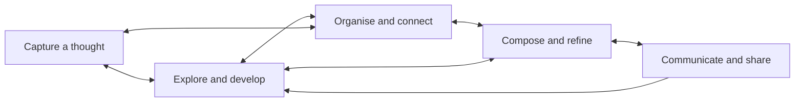
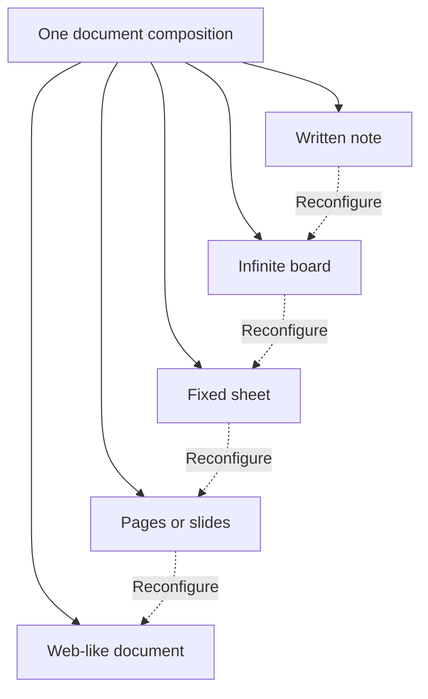
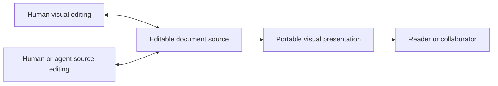

# Penbook — Vision

**Status:** Founding product vision · 28 November 2026  
**Companion documents:** [Architecture](PENBOOK_ARCHITECTURE.md) · [Prototype 01](PENBOOK_PROTOTYPE_01.md) · [Agent guidance](AGENTS.md)

> A personal creative environment in which writing, drawing, collecting, thinking, composing and communicating are different ways of working with the same material.

## 1. Why Penbook exists

Creative work rarely fits neatly into one medium. A thought can begin as a line of handwriting, an image, a paragraph, a loose diagram or a quick spatial arrangement. It may remain a private note, become part of a research collection, develop into an architectural study, or eventually be presented as a polished document. The distinction between capturing, thinking, designing and communicating is often a consequence of the tools available rather than an inherent distinction in the work.

Today those activities tend to be fragmented between text editors, digital notebooks, sketching apps, whiteboards, image boards, vector drawing applications, document-layout tools and presentation software. Each has its own assumptions about what a document is. Moving between them usually means copying, exporting, flattening or reconstructing material. The tools shape the work prematurely.

Penbook aims to remove that unnecessary separation. It is a personal environment for both the temporal and textual aspects of creative work (notes, journals, records and decisions) and its spatial and graphical aspects (sketches, relationships, diagrams and compositions). Neither should be subordinate to the other.

The original Notebook idea was primarily a digital sketchbook, journal and organiser. Graphic Pad explored a more spatial, graphical environment. HTML Notes/HTMDoc explored going beyond plain Markdown through the expressiveness of the web. Penbook is a synthesis of these directions, not simply a text editor with drawings attached or a drawing application with text boxes added.

## 2. What it should feel like

Penbook should feel immediate and unceremonious. Opening a note should be closer to opening a Markdown file or an image than launching a large publishing project. A blank page should invite a pen stroke or a sentence, not require decisions about a complex document type. A small note should remain a small note. Sophisticated functionality should appear when the work calls for it, not occupy the interface all the time.

It should also feel like a precise creative instrument. When needed, a user can organise content on a grid, compose a dimensioned sheet, align objects, work with typography, reuse a layout or produce an interactive study. Precision and freedom are complementary: neither should dictate the entire experience.

The actual document is the primary working surface. Tools adapt to the activity and the material being edited. A sketching session can feel like a dedicated sketchbook; a text document like a focused writing environment; a composition like a graphical layout application. These are configurations of Penbook, not separate product silos.

These are possible journeys, not a prescribed workflow. An isolated sketch or one-line note is as legitimate an outcome as a publication.

## 3. The range of work

| Activity | Intended experience |
|---|---|
| Everyday notes | Quickly open, type and save a small, readable file; use headings, lists, links, images or sketches naturally. |
| Handwriting and sketchbooks | Draw directly with a pen; turn or create pages; make chronological journals and simple illustrated notes. |
| Visual research | Collect references, photographs, captions and observations; rearrange them freely or organise them as structured galleries. |
| Thinking spatially | Brainstorm on an expanding board, make relationships visible, create diagrams or mind maps, group and reorganise material. |
| Graphic work | Create vector diagrams, annotations and illustrations with the precision and control appropriate to them. |
| Document composition | Arrange text, diagrams, graphics and images into reports, posters, architectural sheets and portfolios; work with fixed or flexible formats. |
| Presentation | Use the same underlying content to build slides, paged documents and scrollable or web-like compositions. |
| Interactive exploration | Share selected interactive galleries, diagrams, charts, model viewers or parametric demonstrations when they genuinely improve understanding. |

The early priority is the ordinary daily material: text, images, simple sketches, vector graphics and visual collections. Advanced interactive computational documents are a valuable possibility, not the reason every ordinary note needs to be complicated.

## 4. One document, many configurations

The user should choose how big or small a document is. A book of sketches may be one file, a series of files or a collection of individual pages; a report can contain boards and drawings; a board can contain a carefully formatted note. There is no compulsory notebook/page/section hierarchy.

Rather than prescribing a fixed set of incompatible document types, Penbook offers a common grammar of content, groups and arrangements. A board, note, sketchbook, poster, journal, presentation or web composition is a configuration of that grammar. The user may change how the material is arranged or experienced as the work evolves. Conversions need not always be perfect, but should preserve the content and make their consequences clear.

A sketchbook configuration, for example, can establish page dimensions, a blank drawing on each new page, appropriate navigation and a pen-oriented interface. If a particular page needs photographs, text or annotations, the user can change its composition without leaving the sketchbook or converting to another application.

Presets should make purposeful working environments available instantly without restricting what can be created. They are starting points, active work configurations and reusable preferences, not rigid application modes.

## 5. The document belongs to its creator

Penbook is intended to be local-first and file-first. A document is primarily a file that its creator controls, not a record trapped in an application, account, database or cloud subscription. Files should be easy to organise, copy, rename, archive, inspect and share using ordinary filesystem workflows.

Single-file portability matters especially for the hundreds or thousands of everyday notes and drawings that could accumulate over years. Embedded resources should be the ordinary case, while optional external references may suit large or shared material. Working offline should be normal.

A saved, self-contained document should be understandable and viewable without Penbook installed. An ordinary web browser is an unusually attractive universal viewer. A shared document should contain its visible representation and any deliberately included interactive functionality, not the whole creative application. It should not require a service to make its content accessible.

There is a distinction between interacting with a published document and authoring it. A reader might filter a gallery, orbit a model or change an exposed parameter without changing the author's saved document. A simple sketch or note does not need such interactivity at all.

Long-term durability is an important product goal. During exploratory development, however, it would be counterproductive to promise format stability prematurely. Only test material will be created while the fundamentals are still evolving. A later, deliberate transition to durable production documents should establish the actual compatibility obligations.

## 6. Human and agent authoring

Penbook should be a good tool for a human with a pen, keyboard or mouse, and also a good medium for a coding agent working directly on files. These are complementary creation methods, not two distinct kinds of document.

An agent should be able to make a new document, organise an existing one, add content, revise a layout or apply a repeated transformation without having to simulate every UI gesture. Humans should be able to understand and inspect the meaningful source when needed. Large images or generated presentation should not make small text edits unnecessarily expensive or difficult.

The visual editing experience remains the default. Source access is a complementary capability, not an excuse to make the visual tool less direct.

## 7. Relationship to other tools

Penbook belongs to a broader exploration of personal, file-based creative and design tools. It should benefit from their ideas without becoming an attempt to merge every application into one.

- **Graphic Pad:** the core graphical and compositional capabilities are within Penbook's long-term ambition, including spatial precision, vector editing, diagrams, frames, layouts and graphical exports.
- **Sketchnote:** natural raster drawing and annotation inspire a dedicated pen-first content experience. This complements, rather than replaces, vector graphics.
- **Website Builder / Content Studio:** the core composition capabilities — nested layout, typography, reusable styles and components, structured records and generated galleries — should be achievable in Penbook. Website-specific site routing, publishing and administration remain outside its essential purpose.
- **Archbook and CAD Studio:** remain specialised applications. Architectural views, model representations and editable compositions may eventually travel between environments. Penbook is not a general CAD modelling or computational dataflow platform.
- **Sourcebook:** remains a file and reference organisation environment. It may browse or index Penbook documents; Penbook should not require a global asset database or duplicate Sourcebook's purpose.

The aspiration is compatibility and reuse where it genuinely helps, not mandatory shared code, a monolithic super-app or simultaneous rewrites. A slide layout might become part of a website; an architectural view might become a report figure; a visual study might be reused in a teaching document. Preserve the possibility without forcing integrations before the individual systems are ready.

## 8. Principles that should survive implementations

1. **Equal creative media.** Writing, drawing, visual organisation and graphic composition are first-class.
2. **Immediate everyday use.** Speed, low friction and clarity for the common small document matter more than the breadth of a feature list.
3. **Freedom and precision.** Provide free spatial work and structured arrangements within the same environment.
4. **Composition over categories.** Enable different document experiences through combinations of simple principles, not disconnected file types and editors.
5. **Generative simplicity.** Build general mechanisms from which functionality emerges. Prefer an overlapping graphics block to a report-specific annotation subsystem, for example.
6. **Progressive disclosure.** Contextual tools, presets and modular capabilities should make the interface appropriate to the activity.
7. **Ownership and longevity.** Ordinary files, offline use, inspectable source and independently viewable output are central to the product.
8. **Respect native media.** Keep text, images, vector graphics and computation in suitable, familiar forms rather than reinventing them behind a universal abstraction.
9. **Independence and extensibility.** Let individual capabilities develop deeply without requiring constant redesign of the entire application.
10. **Learn by building.** Establish architectural foundations, test them against real workflows, and introduce capabilities deliberately. Do not let speculative future requirements make the everyday experience heavy.

## 9. What Penbook is not

It is not primarily a publishing CMS, a social platform, a collaborative cloud editor, a CAD kernel, a universal node-graph system, a plugin marketplace or a replacement for every specialist application. It is not an arbitrary web-page editor merely because its presentations use web technologies. It does not need all of these capabilities to be valuable.

It is also not a commitment to implement the entire intended feature set immediately. The application can remain useful at many intermediate stages. The evolving [Architecture](PENBOOK_ARCHITECTURE.md) describes the current theoretical system; individual prototype briefs determine what to build and test next.

## 10. The long-term test

If Penbook succeeds, the creator can open a small file and immediately continue a thought, make a sketch or develop a composition; later return to years of material without depending on a particular version of an application; and share a result that is understandable without asking someone to install the authoring tool.

The best evidence will be actual use: ordinary notes created without hesitation, richer compositions that emerge naturally from earlier work, and a codebase that can acquire new capabilities without becoming progressively harder to understand.
